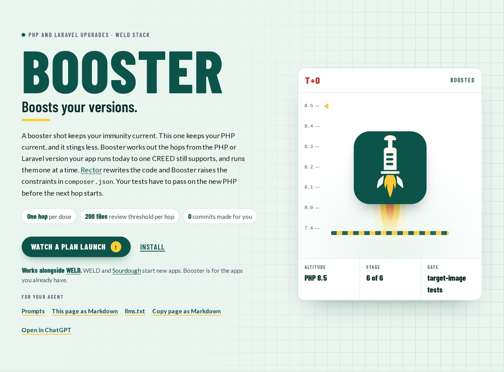
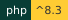
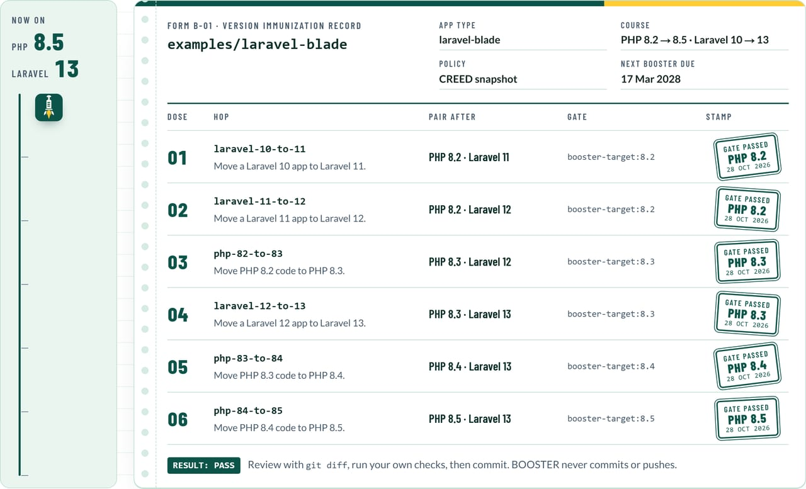
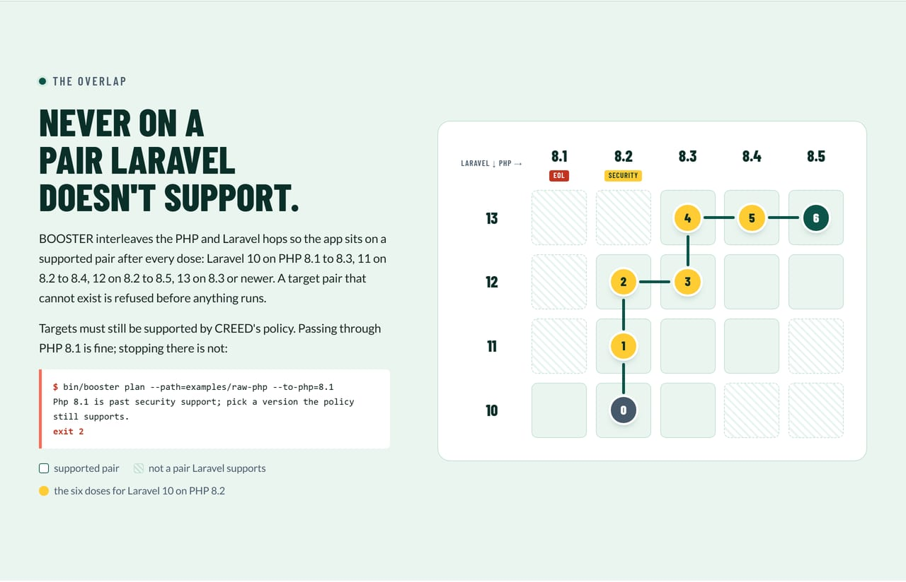
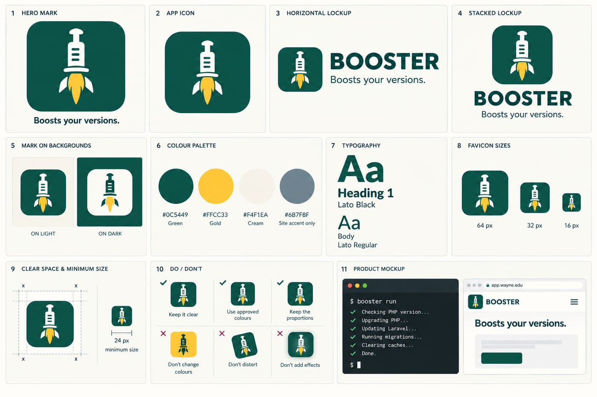

<div align="center">
  <a href="site/index.html"></a>
</div>

# BOOSTER

<p>
  
  
  
  <a href="https://github.com/waynestate/booster/actions/workflows/ci.yml"></a>
</p>

**Boosts your versions.** One dose at a time, and every dose gets a stamp.

Checks: `composer ci` (the same command runs on GitLab and GitHub).

Development happens on Wayne State's GitLab; this repository is a release mirror. Changes land there first.

> A booster shot keeps your immunity current. This one keeps your PHP current, and it stings less.

Front page: [`site/index.html`](site/index.html), a static page you can open in a browser or serve from `site/`.

BOOSTER is WELD's upgrade tool. It plans the hops that take a WSU PHP app from the PHP or Laravel version it runs now
to one the version policy still supports, and it runs them one at a time: [Rector](https://getrector.com) rewrites the
code, BOOSTER raises the constraints in `composer.json`, and the app's own tests must pass on the target PHP before the
next hop starts. It stands on `rector/rector` and `driftingly/rector-laravel` and adds only the ordering, the cap, the
gate and a few WSU recipes.

BOOSTER edits your working copy and prints a report. It never commits, pushes or opens a merge request: a person reads
the diff and merges it.

## Where it fits in WELD

WELD is the Wayne State application stack. BOOSTER is its upgrade layer.

| Part | Job |
|---|---|
| WayneUI (project 0) | The interface layer every other part builds on |
| CREED | The version policy (`policy.json`) BOOSTER reads |
| PROCTOR | Measures an app against that policy; BOOSTER can run it as part of the gate |
| PREFLIGHT | The CI templates |
| SESAME | Auth; BOOSTER can swap `wayne-cas` for it |
| HELMET | The baseline runtime |
| Pinstripe | The coding standard |
| Sourdough | The starters |
| BOOSTER | This project: moves apps forward |

It works for all five permutations of the stack: raw PHP, raw PHP with a Vue SPA, Laravel with Blade, Laravel with
Blade and Vue islands, and Laravel with Inertia and Vue.

## Install

BOOSTER needs PHP 8.3 or newer, but the app it upgrades does not: Rector runs from BOOSTER's own `vendor/`, so an app
on PHP 7.4 is rewritten by a Rector that runs on 8.3 or newer.

Linux and macOS:

```
git clone https://github.com/waynestate/booster.git
cd booster && composer install
bin/booster --version
```

Windows (PowerShell, no bash or WSL needed):

```
git clone https://github.com/waynestate/booster.git
cd booster; composer install
php vendor\bin\booster --version
```

No PHP on the machine? Run it in Docker (the path after `-v` is where your app lives):

```
docker run --rm -v "${PWD}:/booster" -w /booster composer:2 composer install --no-interaction
docker run --rm -v "${PWD}:/booster" -v "C:\path\to\app:/app" -w /booster php:8.4-cli php bin/booster plan --path=/app
```

The `run` command's test gate starts Docker itself, so it needs a Docker daemon on the machine that runs BOOSTER.
When BOOSTER itself runs in a container, use `--skip-gate` and run the tests yourself. Node hops run `npm` in a
`node:24` container, so they need the same daemon but no Node installed on the machine.

## Single-file download

BOOSTER can also be built as a single-file PHAR, so PREFLIGHT and apps without Composer access can run it as one
file. Build it with the script for your OS (both need Docker, and no PHP or Composer on the host):

Windows (PowerShell):

```
.\scripts\build-phar.ps1
```

Linux / macOS:

```
scripts/build-phar.sh
```

Each script writes `build/booster.phar` and verifies it by printing BOOSTER's version. The phar is not published
yet (there is no release step), so build it from a checkout rather than downloading it.

Every command works from the phar. `detect`, `plan`, `hops` and `init` read only what is bundled inside it. `run`
copies Rector, its `config/rector.php` and `docker/` out of the phar into a temp directory first, because Rector and
`docker build` are child processes that cannot be pointed at a `phar://` path; the temp directory is removed when the
command exits.

## Quick start

```
booster detect --path=../my-app        # which of the five permutations, and which versions
booster plan   --path=../my-app        # the ordered hops to a supported version
booster scan   --path=../my-app --php=8.0   # what will break on that PHP; advisory, changes nothing
booster run    --path=../my-app --dry-run   # the diffs Rector would make; changes nothing
booster run    --path=../my-app        # apply the plan, one hop at a time, with a test gate
```

The one-command form for a forced image upgrade:

```
booster run --path=../my-app --goal=php-74-to-84
```

A plan for a Laravel 10 app on PHP 8.2 looks like this (the order keeps the app on a PHP and Laravel pair Laravel
supports at every step):

```
1. laravel-10-to-11  [target-image-tests]
2. laravel-11-to-12  [target-image-tests]
3. php-82-to-83      [target-image-tests]
4. laravel-12-to-13  [target-image-tests]
5. php-83-to-84      [target-image-tests]
6. php-84-to-85      [target-image-tests]
```

<div align="center">
  
  <br><sub>The plan above, written up the way your doctor would: one stamp per hop, one hop at a time.</sub>
</div>

<details>
<summary><b>Chart review</b>: the record card and the PHP by Laravel grid, from the front page</summary>
<br>
<div align="center">
  
  <br><br>
  
</div>
</details>

## Commands

| Command | What it does |
|---|---|
| `booster detect` | Reads `composer.json` and `package.json`; prints the app type, PHP, Laravel, PHPUnit, Vue and Node versions |
| `booster plan` | Prints the ordered hops, the warnings and an advisory PHPCompatibility scan of the first PHP hop's target. Changes nothing. |
| `booster scan` | Advisory PHPCompatibility scan: what will break on `--php`. Exits 0 even with findings |
| `booster run` | Runs the plan. `--dry-run` previews every hop |
| `booster hops` | Lists every hop BOOSTER knows |
| `booster init` | Writes the coding-tab playbooks to `.agents/skills`; `--check` exits 1 when they are stale |

Options shared by `plan` and `run`:

| Option | Meaning |
|---|---|
| `--path` | The app (default `.`) |
| `--format` | `text` (default) or `json` |
| `--policy` | CREED's `policy.json`. Default: `BOOSTER_POLICY`, then the bundled snapshot |
| `--today` | Override today's date (`YYYY-MM-DD`) so runs are repeatable |
| `--goal` | Shorthand such as `php-74-to-84` (sets `--from-php` and `--to-php`) |
| `--from-php`, `--from-laravel` | Say what the app runs on when the manifest does not |
| `--to-php`, `--to-laravel`, `--to-phpunit` | The target. Default: the newest version the policy supports today (PHPUnit: the newest that runs on the target PHP) |
| `--sesame` | Include the `wayne-cas` to SESAME swap |
| `--skip` | A hop id to leave out (repeat it) |

Options for `plan`:

| Option | Meaning |
|---|---|
| `--no-scan` | Skip the advisory PHPCompatibility scan |

Options for `scan`:

| Option | Meaning |
|---|---|
| `--path` | The app (default `.`) |
| `--php` | Required. The PHP version to ask about (`major.minor`, one BOOSTER knows) |
| `--format` | `text` (default) or `json` |

Options for `run`:

| Option | Meaning |
|---|---|
| `--dry-run` | Show the diffs; change nothing; skip git, the baseline and the gate. A Laravel hop without `vendor/` is marked incomplete |
| `--max-changes` | Stop a hop that would change more than this many files (default 50) |
| `--skip-gate` | Do not run the tests in the target image (skips the baseline too) |
| `--allow-failing-baseline` | Continue when the baseline fails; later gate failures are labelled as pre-existing |
| `--allow-dirty` | Run even when the working copy has uncommitted changes |
| `--test-command` | What runs the app's tests in the image (default `composer test`, else `vendor/bin/phpunit`) |
| `--proctor-command` | An extra command run after the tests, for example a PROCTOR check |

Exit codes: `0` pass, `1` the baseline failed or a hop was capped, errored or failed its gate, `2` bad usage (bad
option, unreadable policy, broken `composer.json`, a target the policy does not support).

### The PHPCompatibility scan

`plan` ends with an advisory scan: PHP_CodeSniffer runs the PHPCompatibility standard over the app and asks what will
break on the PHP version the first PHP hop lands on. The findings are hints for the person doing the upgrade, never a
gate: they do not change the exit code, and a scan that cannot run (missing tooling, a crash) is reported as "could
not run" while the plan still prints in full. `--no-scan` skips it.

The scan is optional. BOOSTER looks for a PHP_CodeSniffer that carries the PHPCompatibility standard, trying the app's
own `vendor/bin/phpcs`, then BOOSTER's `vendor/bin/phpcs`, then `phpcs` on the PATH. When none of them has the
standard, the scan reports a skip and the plan goes on. To turn it on, install the packages into the app:

```
composer require --dev phpcompatibility/php-compatibility:"^10.0@alpha"
```

The scan ignores `vendor/`, `node_modules/` and `storage/`, because those hold third-party code and generated files,
not the app's. It reads the app only and changes nothing. `booster scan --path=../my-app --php=8.0` runs the same scan
on its own, for any PHP version BOOSTER knows, and exits 0 even when it finds a wall of removed functions.

### The baseline

Before the first hop, `run` runs the app's own tests on the PHP the app is on now, in the same `booster-target:<php>`
image the gate uses. The point is to tell "BOOSTER broke it" from "it was already broken": a red baseline means the
suite was red before any change, so a later red gate is not proof of a bad hop. The baseline is recorded in the report
(`passed`, `failed` or `skipped`, with the exit code and the last 20 lines of output).

- A red baseline stops the run before the first hop, with a non-zero exit. `--allow-failing-baseline` lets it go on;
  each later gate failure is then labelled "the baseline was already failing" in the text and JSON output.
- `--skip-gate` and `--dry-run` skip the baseline (reported as `skipped`), so a dry run never starts Docker.

### What a hop does

1. Rector runs as a dry run. If it reports errors, or wants to change more files than `--max-changes`, the run stops
   before anything is written.
2. Rector runs for real, with only that hop's rules.
3. `composer.json` is edited: the `php` or `laravel/framework` constraint is raised, and `config.platform.php` moves
   with it. BOOSTER never runs `composer update`.
4. The gate runs the app's tests inside `booster-target:<php>`, a container built from `docker/Dockerfile` on the PHP
   the hop moves to. A red gate stops the run and leaves the changes in place so you can read them
   (`git checkout .` undoes them).

`run` refuses to start on a working copy that is not under git or has uncommitted changes, so the upgrade diff stands
alone. `--dry-run` has no such limit.

A dry run previews every hop against the original tree, so the same file can appear in several hops. The report ends
with the number of unique files and a reminder that nothing was applied. A Laravel hop whose app has no `vendor/`
cannot see the framework's classes, so its preview is marked incomplete and the report says to run `composer install`
first.

Some hops are playbooks only (`vue-2-to-3`): Rector does not read Vue, so BOOSTER lists the steps and the official
guide, and a person does the work. Two hops edit manifests instead of code. `node-pin-24` sets `engines.node` in
`package.json` and writes `.nvmrc`, then the app's usual gate applies. `mix-to-vite` converts a simple
`webpack.mix.js` to Vite (below) and asks for a build gate, which runs `npm ci` and `npm run build` in the `node:24`
container before the app's tests.

### Hops BOOSTER knows

PHP one minor at a time from 5.6 to 8.5; Laravel one major at a time from 8 to 13; PHPUnit one major at a time from 9
to 13; `cas-to-sesame` (a stub recipe that renames the `wayne-cas` classes to SESAME's compatibility classes and swaps
the Composer requirement); `node-pin-24` (planned for any app with a `package.json` that does not already floor Node at
24 or newer: sets `engines.node` to `>=24` and writes `.nvmrc`, ahead of the front-end hops); `mix-to-vite` (planned
when the app has a `webpack.mix.js` and the plan lands on Laravel 9 or newer, after `node-pin-24`: writes
`vite.config.js`, swaps `laravel-mix` for `vite` and `laravel-vite-plugin` in `package.json`, renames `MIX_` keys to
`VITE_` in `.env.example`, rewrites Blade `mix()` script and link tags into one `@vite([...])` line per layout when
every referenced asset maps to a Mix entry, and deletes `webpack.mix.js`; the simple shape only: `mix.js`, `.vue()`,
`.sass()`, `.postCss()` and `.version()`, anything else is refused by name, a Vue 2 front end must take `vue-2-to-3`
first, and `withoutMix()` calls are listed for a manual rename to `withoutVite()`); and `vue-2-to-3` (playbook).
`booster hops` prints them all.

BOOSTER plans only what the policy supports as a target. Moving to PHP 8.1 is refused because 8.1 is past security
support; passing through it on the way to a newer version is fine.

## Configuration

| Variable | Meaning | Default |
|---|---|---|
| `BOOSTER_POLICY` | Path to CREED's `policy.json` | the generated copy in `src/Creed/policy.json` |

The copy in `src/Creed/` (reader, `policy.json` and manifest) is generated from CREED by its `bin/export.php`, not
written by hand: point `CREED_PATH` at a CREED checkout and run `composer creed-copy:check` to verify the copy has
not drifted (it exits non-zero on a hand edit or a newer CREED).

`.env.example` holds the placeholder. BOOSTER reads no secrets, makes no network calls of its own and talks to no
Citadel host. Everything it prints from an app (file names, diffs) has control characters stripped.

When Rector runs, BOOSTER passes it a few `BOOSTER_*` variables of its own (the app path, the sets, the PHP target).
They are internal; do not set them.

## Laravel hops and `vendor/`

rector-laravel needs Laravel's classes to recognise a model or a controller. For a Laravel hop BOOSTER loads the app's
own `vendor/autoload.php` when it exists, so run `composer install` in the app first. PHP hops never load the app's
autoloader. An app with no `vendor/` still gets a plan and the hops that do not need Laravel's classes.

## Checks

```
composer ci
```

runs `composer validate --strict`, PHPUnit, Pint, PHPStan (Pinstripe's raw preset, still inlined; `waynestate/pinstripe`
is on Packagist now, so it can become a dev requirement) and `composer audit`. Nothing needs PHP on the host:

```
docker run --rm -v "${PWD}:/app" -w /app composer:2.10.3 sh -c "composer install --no-interaction && composer ci"
```

`contract/expectations.json` says what BOOSTER must detect, plan and change for each example app in `examples/`;
`tests/ContractTest.php` enforces it with the real Rector, so a Rector release that changes a hop shows up in CI.

## Status

Version 0.1. See [OPEN_QUESTIONS.md](OPEN_QUESTIONS.md) for what a person must answer and what is not built yet, and
[BEST_PRACTICES.md](BEST_PRACTICES.md) for the rules BOOSTER follows.

## Licence

MIT, Wayne State University, Enterprise Applications.

<details>
<summary><b>The brand board</b>: the syringe that is also a rocket, lockups, palette and type</summary>
<br>
<div align="center"></div>
</details>

<div align="center"><b>The whole course</b><br><sub>WayneUI and the stack. Each one is on its own schedule; this one keeps the schedule.</sub></div>

<div align="center">
  <a href="https://github.com/waynestate/wayne-ui" title="WayneUI"></a>
  <a href="https://github.com/waynestate/creed" title="CREED"></a>
  <a href="https://github.com/waynestate/proctor" title="PROCTOR"></a>
  <a href="https://github.com/waynestate/sesame" title="SESAME"></a>
  <a href="https://github.com/waynestate/helmet" title="HELMET"></a>
  <a href="https://github.com/waynestate/sourdough" title="Sourdough"></a>
  <a href="https://github.com/waynestate/squire" title="SQUIRE"></a>
  <a href="https://github.com/waynestate/preflight" title="PREFLIGHT"></a>
  <a href="https://github.com/waynestate/pinstripe" title="Pinstripe"></a>
  <a href="https://github.com/waynestate/booster" title="BOOSTER"></a>
  <a href="https://github.com/waynestate/rollcall" title="ROLLCALL"></a>
  <a href="https://github.com/waynestate/drawbridge" title="DRAWBRIDGE"></a>
  <a href="https://github.com/waynestate/advisor" title="ADVISOR"></a>
  <a href="https://github.com/waynestate/weld" title="WELD"></a>
</div>

<div align="center"><sub>Images are regenerated from the front page by <a href="scripts/readme-art/README.md"><code>scripts/readme-art</code></a>. Please hold still; this will only sting a little.</sub></div>
