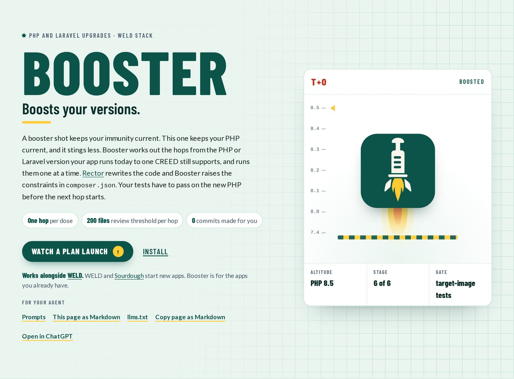
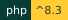
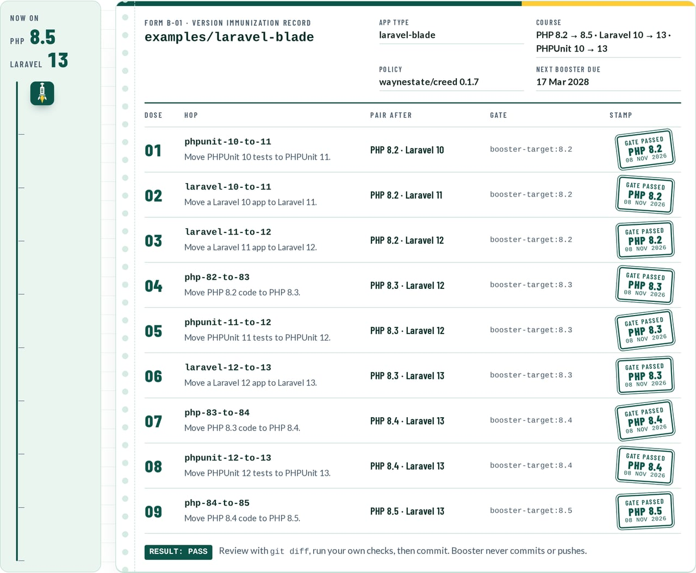
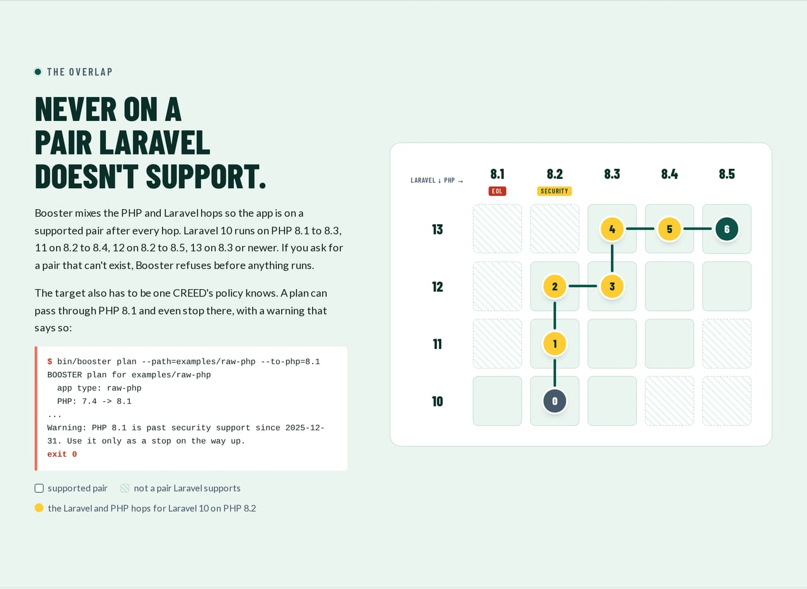
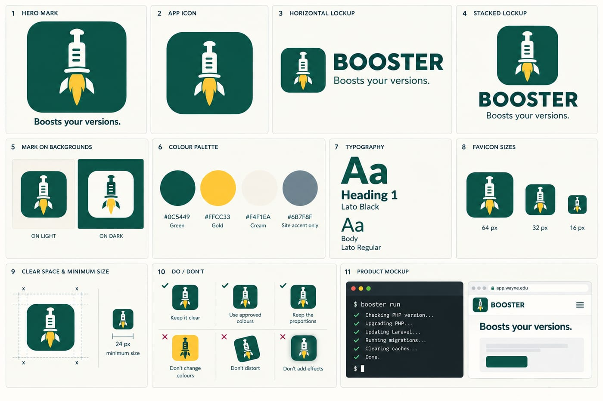

<div align="center">
  <a href="site/index.html"></a>
</div>

# Booster

<p>
  
  
  
  <a href="https://github.com/waynestate/booster/actions/workflows/ci.yml"></a>
</p>

**Boosts your versions.** One dose at a time, and every dose gets a stamp.

## Run it today

With PHP 8.3 or newer on the machine, from the folder of the app you want to upgrade:

```
curl -L -o ../booster.phar https://github.com/waynestate/booster/releases/latest/download/booster.phar
php ../booster.phar detect
php ../booster.phar plan
php ../booster.phar run --dry-run
```

Those three change nothing. Run `composer install` in the app first: without `vendor/`, Rector and PHPStan cannot
see the classes your packages provide, so `plan` and the dry run preview less and open with a warning saying so.
`run` makes the edits (it needs git, a clean working copy and Docker for the test gate) and never commits. The file sits one folder up so it stays out of the app's git; on Windows PowerShell, type
`curl.exe` instead of `curl`. Keeping it on your PATH, a clone, and Docker only (no PHP) are under [Install](#install).

**Not to be confused with:** Booster moves an app to a newer PHP or framework version; Pinstripe's Rector set only modernizes code within the PHP version the app already runs.

Checks: `composer ci` (the same command runs on GitLab and GitHub).

Documentation: the docs live at [booster.apps.wayne.edu/docs/](https://booster.apps.wayne.edu/docs/) and are built from `docs/` by `bin/docs-site.php`.

## Where the code lives

The canonical repository is [enterprise-apps/booster](https://git.wayne.edu/enterprise-apps/booster) on git.wayne.edu: clone it as `git@git.wayne.edu:enterprise-apps/booster.git`, open issues and merge requests there, and make its tags there, by the maintainer, with an approver.
GitHub ([waynestate/booster](https://github.com/waynestate/booster)) is a read-only push mirror of it, for the published package: nobody pushes to it, and Packagist reads from it.
git.wayne.edu is the shot; the mirror is the bandage.

> A booster shot keeps your immunity current. This one keeps your PHP current, and it stings less.

Front page: [`site/index.html`](site/index.html), a static page you can open in a browser or serve from `site/`.
On Citadel it is served by the raw-PHP deploy layer in [`deploy/`](deploy/): a Squire kit whose front controller serves `site/` behind HELMET's security headers. For local development, keep serving `site/` directly.

Docs: the same site serves the documentation at [`/docs/`](https://booster.apps.wayne.edu/docs/). It is built from [`docs/`](docs/) by `bin/docs-site.php` (`composer docs`), the built pages are committed, and `composer docs:check` (part of `composer ci`) fails when they drift from the sources. The docs wear the front page's look through the builder's `theme` key in `docs/docs.json`: [`docs/_header.html`](docs/_header.html) is the masthead every docs page gets (keep its links in step with the front page's), and [`docs/theme/booster.css`](docs/theme/booster.css) holds the palette, type, code blocks and the dark mode it shares with the front page (section 12 of `site/assets/booster.css`; change one, change both); the build copies it to `site/docs/theme/`. Edit those two files, never `site/assets/docs.css` or `docs.js` (Squire's kit), then run `composer docs`. Like a booster shot, it only works if you actually take it.

Booster is WELD's upgrade tool. It plans the hops that take a WSU PHP app from the PHP or Laravel version it runs now
to one the version policy still supports, and it runs them one at a time: [Rector](https://getrector.com) rewrites the
code, Booster raises the constraints in `composer.json`, and the app's own tests must pass on the target PHP before the
next hop starts. It stands on `rector/rector` and `driftingly/rector-laravel` and adds only the ordering, the review
threshold, the gate, the advisory scans and a few WSU recipes.

Booster edits your working copy and prints a report. It never commits to, pushes or opens a merge request on your app (the only merge requests it opens are its own hop-data refresh on Booster itself): a person reads
the diff and merges it.

## Where it fits in WELD

WELD is the Wayne State application stack. Booster is its upgrade layer.

| Part | Job |
|---|---|
| WayneUI (project 0) | The interface layer every other part builds on |
| CREED | The version policy (`policy.json`) Booster reads |
| PROCTOR | Measures an app against that policy; the gate runs it before the first hop and after the last |
| SESAME | Auth; Booster can swap `wayne-cas` for it |
| HELMET | The baseline runtime |
| Sourdough | The starters |
| Squire | The Citadel deploy kit; the layer that serves this repo's front page is one |
| Parity | Citadel on your computer: its PHP image, its proxy and MySQL 5.6, so an app that works here works on Citadel. Try an upgraded app there before you deploy it |
| Preflight | The CI templates |
| Pinstripe | The coding standard |
| Booster | This project: moves apps forward |
| Rollcall | The fleet census: which apps run what, and how close each is to end of life |
| Drawbridge | The one OpenID Connect front door for the Citadel |
| ADVISOR | The read-only MCP server that answers a coding agent's stack questions |
| WELD | The Laravel starter app with the rest of the stack already set up |

It works for all five permutations of the stack: raw PHP, raw PHP with a Vue SPA, Laravel with Blade, Laravel with
Blade and Vue islands, and Laravel with Inertia and Vue.

## Install

Run Booster from inside the app you want to upgrade: `--path` defaults to `.`, so `booster plan` needs no flags.
Booster needs PHP 8.3 or newer on the machine; the app it upgrades does not, because Rector runs from Booster's own
`vendor/`.

### Single file (PHAR)

```
mkdir -p ~/bin
curl -L -o ~/bin/booster.phar https://github.com/waynestate/booster/releases/latest/download/booster.phar
alias booster='php ~/bin/booster.phar'    # put this line in ~/.bashrc or ~/.zshrc to keep it
cd /path/to/your-app
booster detect
booster plan
booster run --dry-run
booster run
```

`detect` reads the app and prints its type and versions. `plan` lists the steps. `run --dry-run` previews the edits
and changes nothing. `run` edits files and makes no commit. A real `run` also needs git, a clean git folder (commit
or stash first) and a Docker daemon for its test gate.

On Windows PowerShell, the same single file (`curl.exe` ships with Windows 10 and 11):

```
New-Item -ItemType Directory -Force "$HOME\bin" | Out-Null
curl.exe -L -o "$HOME\bin\booster.phar" https://github.com/waynestate/booster/releases/latest/download/booster.phar
function booster { php "$HOME\bin\booster.phar" @args }   # put this line in $PROFILE to keep it
cd C:\path\to\your-app
booster detect
booster plan
booster run --dry-run
booster run
```

### Linux, macOS and WSL (Ubuntu): clone it

```
sudo apt install php-cli php-xml php-mbstring php-zip php-curl unzip git composer
```

Ubuntu splits the XML extension out of `php-cli`, and Composer's dev dependencies need it: when Composer says
"ext-dom is missing", run the line above. On macOS: `brew install php composer git`. Ubuntu 22.04 ships PHP 8.1, too
old for Booster: add the [ondrej/php PPA](https://launchpad.net/+ppas?field.name=php&field.status=active) or use
the Docker route below. Then:

```
git clone https://github.com/waynestate/booster.git
cd booster && composer install
bin/booster --version
```

Run Booster from its own folder with `--path` pointing at the app; never clone Booster inside an app:

```
bin/booster plan --path=/path/to/your-app
```

`--path` takes a path, and a leading `~` means your home folder (from `HOME`, or `USERPROFILE` on Windows). In WSL,
keep Booster and the app in your Linux home folder, not under `/mnt/c` (a Windows drive is slow from Linux); a
Windows folder is `/mnt/c/Users/<you>/...`, and `run` needs Docker Desktop's WSL integration switched on.

### Windows PowerShell, with PHP and Composer installed

```
git clone https://github.com/waynestate/booster.git
cd booster; composer install
php bin\booster --version
php bin\booster plan --path=..\my-app
```

### Docker only, no PHP (Windows or any OS)

```
git clone https://github.com/waynestate/booster.git
cd booster
docker run --rm -v "${PWD}:/booster" -w /booster composer:2.11.1@sha256:8de2184c6de224f4689e8f80ed5f5edaf0030b6b8b7839a22a2bcb6722ac87d0 composer install --no-interaction
docker run --rm -v "${PWD}:/booster" -v "/path/to/app:/app" -w /booster php:8.4-cli php bin/booster plan --path=/app
```

Run these from inside the booster folder.

This route can run `detect`, `plan`, `scan` and `run --dry-run`. A real `run` starts Docker and uses git from inside
Booster, which the `php:8.4-cli` image lacks, so for a real run use the single-file or clone route (in WSL on Windows). When
Booster itself runs in a container, pass `--skip-gate` to `run` and run the tests yourself. Node hops run `npm` in a
`node:<major>` container (26 unless the plan pins another Node), so they need the same daemon but no Node installed on the machine.

Booster prints its progress lines on standard error. In Windows PowerShell they print in red, as if they were errors. They are not errors; the exit code tells you whether the run worked.

Booster is also on Packagist as `waynestate/booster`: give it its own folder, not your app's `vendor/`, because it
needs PHP 8.3 even when your app doesn't. Clone it as above, or run
`composer create-project waynestate/booster booster ^1.0`.

## Single-file download

Booster ships as a single-file PHAR, so Preflight and apps without Composer access can run it as one file. The first route
above downloads it; every version tag publishes the same `booster.phar`: the GitLab release carries it as an asset,
and the GitHub release at github.com/waynestate/booster carries it as an attachment. Run it with `php booster.phar`.

You can also build it from any commit, with the script for your OS (both need Docker, and no PHP or Composer on the
host):

Windows (PowerShell):

```
.\scripts\build-phar.ps1
```

Linux / macOS:

```
scripts/build-phar.sh
```

Each script writes `build/booster.phar` and verifies it by printing Booster's version.

Every command works from the phar. `detect`, `plan`, `hops` and `init` read only what is bundled inside it. `run`
copies Rector, its `config/rector.php` and `docker/` out of the phar into a temp directory first, because Rector and
`docker build` are child processes that cannot be pointed at a `phar://` path; the temp directory is removed when the
command exits.

## Quick start

```
booster detect --path=../my-app        # which of the five permutations, and which versions
booster plan   --path=../my-app        # the ordered hops to a supported version
booster scan   --path=../my-app --php=<target>   # what will break on that newer PHP; advisory, changes nothing
booster run    --path=../my-app --dry-run   # the diffs Rector would make; changes nothing
booster run    --path=../my-app        # apply the plan, one hop at a time, with a test gate
booster init   --path=../my-app        # optional: writes playbooks for AI coding tools into the app; commit them before a real run
```

Replace `<target>` with the PHP version you are heading for, for example the one `plan` shows on its last step.

A real run needs git and Docker on the machine that runs Booster. If you used the Docker-only route, the first four commands above work as they are, but the last one does not: its `php:8.4-cli` image has no git. Use the single-file or clone route for `booster run` (see Install).

Booster prints its progress lines on standard error. In Windows PowerShell they print in red, as if they were errors. They are not errors; the exit code tells you whether the run worked.

### What a run does by default

You can run `detect`, `plan` and `run` on an app with nothing after `--path`. Booster then goes as far as it safely can on its own: it climbs to the newest PHP and Laravel that CREED's policy supports today, which is PHP 8.5 and Laravel 13 as of this writing (the policy file is the source of truth, not this page).

| Command | With no other flags |
| --- | --- |
| `booster detect` | Reads `composer.json` and `composer.lock`, and reports PHP, Laravel, PHPUnit and the front-end setup. Changes nothing. |
| `booster plan` | Starts from what `detect` found and plans every hop up to the newest PHP, Laravel and PHPUnit the policy supports. Changes nothing. |
| `booster run` | Does the whole plan in one go, in order. |

How many hops? One for every step on the way, never a jump:

- one hop per PHP minor (8.1 to 8.2 is a hop, 8.2 to 8.3 is another),
- one hop per Laravel major,
- one hop per PHPUnit major.

Booster interleaves them so the app sits on a PHP and Laravel pair that Laravel supports at every step: a Laravel step as soon as the current PHP allows it, a PHPUnit step when the PHP allows it, a PHP step otherwise. Two real examples: a Laravel 10 app on PHP 8.1 with PHPUnit 10 plans 10 hops (more with front-end Node hops), and a PHP 5.5 app with no framework plans 12 hops to PHP 8.5.

Some hops come along by default, and some only when you ask:

- The front-end Node hops (Mix to Vite, Vite major, Tailwind, TypeScript, Vue) are in the plan by default. Pass any target (`--goal`, `--to-php`, `--to-laravel`, `--to-phpunit`, `--from-php`, `--from-laravel`) and they drop out with a warning, unless you add `--with-node`.
- An app on PHPUnit 8 or older gets a manual PHPUnit 9 step before the first PHP 8 hop.
- The SESAME move (`--sesame`), the WayneUI move (`--wayneui`), the move of hand-copied libraries to Composer (`--vendored`) and strict session IDs for a raw PHP app (`--strict-session`) are opt-in only.
- `--skip <hop id>` drops a hop you do not want.
- If you pass a target past security support, the plan still goes there as a stop on the way up and warns with the date its support ended. If Rector has no ruleset for a step yet, the plan stops short and warns.

`run` handles each hop the same way: a Rector preview, then the edits (if a hop would change more than 200 files it asks first, or stops when it cannot ask; `--max-changes` sets a hard limit), then the Composer constraints, then your tests in the target PHP image. That last part is the gate. The first hop that fails stops the run, and the hops after it are reported as "not run". Fix the cause, commit (with the `booster-hop.json` the run wrote) and run again: the stopped hop's gate runs again before the run carries on, so it is neither redone nor skipped ([After a stop](docs/recipes.md#14-after-a-stop)). Booster never commits; the changes sit in your working copy for you to review. Progress prints a line as the baseline starts and ends (`baseline: passed, 150 s`; the first run on a machine builds the gate image, so it takes a few minutes), one line per hop, like `hop 3/11 <hop id>: <status>, 12 files, 41 s`, and ends with `run finished: 11 of 11 hops run, 0 stopped, total ...`, a total that counts the baseline.

Looking for a specific situation (only PHP, one hop at a time, backend only, a big app, no tests)? See [How do I...](docs/recipes.md).

Want less than the whole climb (we will not judge, it is a long way up)?

- `--dry-run` previews every hop and changes nothing.
- `--until <hop id>` keeps that hop and everything before it.
- `--only <hop id>` runs just that one hop.
- `--to-php` and `--to-laravel` pick a lower target.

The one-command form for a forced image upgrade:

```
booster run --path=../my-app --goal=php-74-to-84
```

When the app carries a `composer.lock`, `detect` also reads the PHP range the locked packages allow: the highest
`require.php` floor and the lowest ceiling across `packages` and `packages-dev`, raised by a `platform-overrides.php`
or `config.platform.php` pin in `composer.json` when one is set. If that floor sits above the floor `composer.json`
claims, Booster plans from the lock's floor and prints a warning saying so; if the first PHP hop lands at or above
the lock's ceiling, a second warning says that hop's gate updates the locked packages that stop it (item 5 of
[What a hop does](#what-a-hop-does)).
Without a lock, `composer.json` stays the sole source.

A plan for the bundled Laravel 10 example app on PHP 8.2 looks like this (the order keeps the app on a PHP and
Laravel pair Laravel supports at every step):

```
$ booster plan --path=examples/laravel-blade --today=2026-10-29

BOOSTER plan for examples/laravel-blade
  app type: laravel-blade
  PHP: 8.2 -> 8.5
  Laravel: 10 -> 13
  PHPUnit: 10 -> 13
  policy: waynestate/creed 0.1.8 (today 2026-10-29)

1. phpunit-10-to-11
   Move PHPUnit 10 tests to PHPUnit 11.
   After this step your tests run in Docker.
2. laravel-10-to-11
   Move a Laravel 10 app to Laravel 11.
   After this step your tests run in Docker.
3. laravel-11-to-12
   Move a Laravel 11 app to Laravel 12.
   After this step your tests run in Docker.
   Behavior changes to check:
   When the app does not define a local disk, its root now defaults to storage/app/private instead of storage/app (config/filesystems.php)
     keep old: define the local disk with 'root' => storage_path('app')
     check: Check where Storage::disk('local') writes after the hop
4. php-82-to-83
   Move PHP 8.2 code to PHP 8.3.
   After this step your tests run in Docker.
   Removed between PHP 8.2 and PHP 8.3: none found.
5. phpunit-11-to-12
   Move PHPUnit 11 tests to PHPUnit 12.
   After this step your tests run in Docker.
6. laravel-12-to-13
   Move a Laravel 12 app to Laravel 13.
   After this step your tests run in Docker.
   Behavior changes to check:
   When the app does not set its session cookie name, Laravel 13 derives the fallback name from APP_NAME differently, so the name can change and every signed-in user is signed out once after the deploy (config/session.php)
     keep old: set SESSION_COOKIE in .env to the cookie name the app sends today
     check: Compare the session cookie name in the browser before and after the hop
   When the app does not set a cache prefix, Laravel 13's fallback changes from app_name_cache_ to app-name-cache- (and the Redis prefix from _database_ to -database-), so every cached value misses once after the deploy and keys shared with other code stop matching (config/cache.php)
     keep old: set CACHE_PREFIX (and REDIS_PREFIX when the app uses Redis) in .env to the values the app uses today
     check: Compare a cache key in the store before and after the hop
7. php-83-to-84
   Move PHP 8.3 code to PHP 8.4.
   After this step your tests run in Docker.
   Removed between PHP 8.3 and PHP 8.4: none found.
8. phpunit-12-to-13
   Move PHPUnit 12 tests to PHPUnit 13.
   After this step your tests run in Docker.
9. php-84-to-85
   Move PHP 8.4 code to PHP 8.5.
   After this step your tests run in Docker.
   Removed between PHP 8.4 and PHP 8.5: none found.

PHPCompatibility check for PHP 8.3: no findings.

PHPStan on PHP 8.5: 5 findings (code quality hints, not upgrade blockers).
   app/Models/Post.php:7 [class.notFound] Class App\Models\Post extends unknown class Illuminate\Database\Eloquent\Model.
   app/Models/Post.php:9 [missingType.property] Property App\Models\Post::$casts has no type specified.
   tests/PostTest.php:18 [property.onlyWritten] Property App\Tests\PostTest::$repository is never read, only written.
   tests/PostTest.php:27 [staticMethod.deprecated] Call to deprecated method isType() of class PHPUnit\Framework\Assert:
https://github.com/sebastianbergmann/phpunit/issues/6052
   tests/PostTest.php:33 [method.alreadyNarrowedType] Call to method PHPUnit\Framework\Assert::assertNotNull() with PHPUnit\Framework\MockObject\Rule\AnyInvokedCount will always evaluate to true.
   Hint: Laravel app without Larastan: Eloquent and facade calls show as errors. composer require --dev larastan/larastan for a cleaner scan.

Nothing was changed. The numbered list above is the order Booster would do things; "PHPCompatibility check" and "PHPStan" are advice
for you to read, not errors.
Booster does every numbered step above when you run it.
Preview the edits: booster run --path=examples/laravel-blade --today=2026-10-29 --dry-run
(The real run needs Docker, and your app committed in git: booster run --path=examples/laravel-blade --today=2026-10-29)
```

<div align="center">
  
  <br><sub>The plan's Laravel and PHP hops, written up the way your doctor would: one stamp per hop, one hop at a time.</sub>
</div>

<details>
<summary><b>Chart review</b>: the record card and the PHP by Laravel grid, from the front page</summary>
<br>
<div align="center">
  
  <br><br>
  
</div>
</details>

## Commands

| Command | What it does |
|---|---|
| `booster detect` | Reads `composer.json` and `package.json`; prints the app type, PHP, Laravel, PHPUnit, Vue, Node and Boost |
| `booster plan` | Prints the ordered hops, the warnings (including which direct dependencies block which hops), a removals line per PHP hop, a behavior-changes block per PHP and Laravel hop, an advisory PHPCompatibility scan of the first PHP hop's target and a PHPStan scan at the destination PHP. Changes nothing. |
| `booster scan` | Advisory scans of one PHP version: PHPCompatibility by default, `--removals` for removed functions, `--phpstan` for static analysis. Exits 0 even with findings |
| `booster run` | Runs the plan. `--dry-run` previews every hop |
| `booster hops` | Lists every hop Booster knows |
| `booster init` | Writes the coding-tab playbooks to `.agents/skills`; `--check` exits 1 when they are stale |
| `booster replay` | The replay gate's file and baseline: `init` drafts `booster-replay.json`, `record` saves how the app answers, `check` replays and compares (see below) |

Options shared by `plan` and `run`:

| Option | Meaning |
|---|---|
| `--path` | The app (default `.`); a leading `~` means your home folder |
| `--format` | `text` (default) or `json` |
| `--policy` | CREED's `policy.json`. Default: `BOOSTER_POLICY`, then the copy in the `waynestate/creed` package |
| `--today` | Override today's date (`YYYY-MM-DD`) so runs are repeatable |
| `--goal` | Shorthand such as `php-74-to-84` (sets `--from-php` and `--to-php`) |
| `--from-php`, `--from-laravel` | Say what the app runs on when the manifest does not |
| `--to-php`, `--to-laravel`, `--to-phpunit` | The target. Default: the newest version the policy supports today (PHPUnit: the newest that runs on the target PHP) |
| `--sesame` | Include the `wayne-cas` to SESAME swap |
| `--wayneui` | Include the WayneUI 1.x to 2.x move |
| `--vendored` | Include the move of hand-copied Doctrine 2, Smarty 3 and Slim 1 out of `vendor/` and onto Composer ([the guide](docs/guides/framework-hops.md)) |
| `--strict-session` | Include the hop that turns on `session.use_strict_mode` and `session.use_only_cookies` before each `session_start()` in a raw PHP app ([the guide](docs/guides/strict-sessions.md)) |
| `--skip` | A hop id to leave out (repeat it) |
| `--no-package-check` | Skip the Packagist dependency check (for offline use) |
| `--until` | Cut the plan after this hop id: that step and everything before it stay, and the plan's targets move to where it lands |
| `--only` | Plan and run just this one hop id. The app must sit on the hop's starting versions, and `--until` and `--only` are never combined |
| `--with-node` | include the Node front-end hops (Node pin, Mix to Vite, Vite major, Tailwind, TypeScript, Vue) even when you passed a target version. Without it, any of `--goal`, `--to-php`, `--to-laravel`, `--to-phpunit`, `--from-php` or `--from-laravel` leaves those hops out, and the plan prints: "Node front-end hops were left out because you passed a target version: <hop ids>. Add --with-node to include them." |
| `--node` | the Node major `node-pin-24` floors the app at (22, 24 or 26 today; the policy must still support it). Without it, Booster takes the Node the app's Citadel image ships, read from `NODE_IMAGE` in the Squire kit's `.squire/base-fallback.Dockerfile`, and otherwise the newest Node the policy supports. The plan says which one and why. Implies `--with-node` |

Example: an app moving from Laravel 8 to 13 takes the climb in parts. `booster plan --path=../my-app --until=laravel-8-to-9` keeps every hop up to and including the move to Laravel 9, and `booster run` with the same flag applies exactly those hops.

Options for `plan`:

| Option | Meaning |
|---|---|
| `--no-scan` | Skip the advisory scans (PHPCompatibility and PHPStan) |

Options for `scan`:

| Option | Meaning |
|---|---|
| `--path` | The app (default `.`); a leading `~` means your home folder |
| `--php` | Required. The PHP version to ask about (`major.minor`, one Booster knows) |
| `--removals` | List uses of functions and constructs removed in PHP up to `--php`, instead of the PHPCompatibility scan |
| `--phpstan` | Also run the PHPStan scan (Pinstripe preset) at the same PHP version |
| `--format` | `text` (default) or `json` |

Options for `run`:

| Option | Meaning |
|---|---|
| `--dry-run` | Show the diffs; change nothing; skip git, the baseline and the gate. A Laravel hop without `vendor/` is marked incomplete |
| `--max-changes` | Hard limit on files changed per hop, with no prompt (`0` lifts the limit). Without it, a hop over the review threshold of 200 files asks first when interactive, or stops |
| `--memory-limit` | Memory limit for the Rector process (for example `2G`), or `-1` for no limit (default `2G`) |
| `--skip-gate` | Do not run the tests in the target image after each hop, or the PROCTOR check at the end (skips the baseline too) |
| `--image` | Run the gate in this Docker image instead of building `booster-target` (it needs `php` and `composer` on `PATH`): one name, a `{php}` template or a version map (below) |
| `--allow-failing-baseline` | Continue when the baseline fails; later gate failures are labeled as pre-existing |
| `--allow-dirty` | Run even when the working copy has uncommitted changes |
| `--test-command` | What runs the app's tests in the image (default `composer test`, else `vendor/bin/phpunit`, else the built-in `php -l` syntax check when the app has no tests) |
| `--test-env` | Environment variable (`KEY=VALUE`) passed to the baseline and every gate container with `-e`; repeat it. The report names the keys only, never the values |
| `--proctor-command` | An extra command run in the image after the tests, for example a PROCTOR check |
| `--replay[=FILE]` | Record how the app answers the requests in `booster-replay.json` (or FILE) before the first hop, replay them after every hop's tests, and fail the hop on a changed answer. Off by default |
| `--replay-out` | Where the replay transcripts go (default: a new `booster-replay-<app>-<time>` folder in the temp folder) |
| `--proctor-advisory` | Report the PROCTOR result but do not fail the run on it. Applied automatically when the run stops before the final target (`--until`, `--only`, or a target past security support) |

Exit codes: `0` pass, `1` the baseline failed, a hop was capped, errored or failed its gate, or the PROCTOR check
found new findings, `2` bad usage (bad option, unreadable policy, broken `composer.json`, a target the policy does
not know).

### Which command when

<!-- which-command-when: canonical copy in WELD docs/reference/which-command.md; edit there first, then copy word for word -->
Several stack commands sound alike (`weld:doctor`, `squire doctor`, `proctor check`) and do different jobs. Find your question in the second column and run the command beside it. The doctors look at setup, the proctor grades against policy, and the gate decides deploys: same waiting room, different appointments.

| Command | What it checks | When to run it | Where it runs |
|---|---|---|---|
| `composer ci` | **Will my pipeline pass?** The repo's own CI contract, the same command the pipeline runs: validation, the tests, Pint, PHPStan, `composer audit` and whatever checks the repo adds. | Before every push. | App repo, CI |
| `bin/weld.sh doctor` or `.\bin\weld.ps1 doctor` (both run `php artisan weld:doctor`) | **Does my WELD app hold together?** The app key, writable `storage` and `bootstrap/cache`, the database connection and pending migrations. One PASS, WARN or FAIL line each; exit 1 on a FAIL. Standards are PROCTOR's. | After `up`, when the app will not start, and after every deploy off Citadel. | App repo (in the app container), deploy host (in the app container) |
| `vendor/bin/squire doctor` | **Is my Citadel release setup right?** `build.sh`, the release scripts, the health check, script hygiene, line endings, secrets kept out of git and the local parity setup, against Squire's rules. Exit 1 on a failed rule. The lock file, audit and MySQL 5.6 checks are handed to PROCTOR. | After `squire init` or `squire update`, and before the first deploy. | App repo, CI |
| `vendor/bin/squire init --check` | **Have the files Squire wrote drifted from its templates?** Missing, outdated or edited copies. Writes nothing; exit 1 on drift. | After you upgrade Squire (then run `squire update`), and in CI. | App repo, CI |
| `vendor/bin/squire doctor oracle`, or `php artisan oracle:check` in WELD and Sourdough's Laravel apps | **Can my app reach Oracle?** The `ORACLE_*` settings, the host, the port, the `oci8` driver and the login, in plain language, printing setting names and never values. Silent when the app has no Oracle settings. | After you fill in the `ORACLE_*` settings, or when a connection fails. Squire's `release.sh` runs the same check on every release, as a report. | App repo, deploy host |
| `vendor/bin/proctor check` (`composer proctor` in WELD and Sourdough's apps) | **Does my app meet CREED's policy?** The PHP floor, Laravel, Node and MySQL end of life, the committed lock, `composer audit`, open-ended constraints, portability, MySQL 5.6 safety, overrides and the rest of its checks. Exit 1 on a FAIL. | Before you merge; the pipeline runs it too. | App repo, CI |
| `vendor/bin/proctor gate` | **May this commit deploy?** The deploy-time subset of `proctor check`, ratcheted against the last release's verdict, so a deploy that makes nothing worse goes. Exit 1 is a no-go. | At deploy time. Squire's `release.sh` calls it for you. | Deploy host |
| `sourdough manifest --check` | **Which managed files did I change since Sourdough baked my app?** Managed files that changed or are missing against `.sourdough/manifest.json`; seeded files are yours and never reported. Exit 1 on a change. | Before `sourdough feed`. | App repo, CI |
| `sourdough feed --dry-run` | **Is my app behind its Sourdough template?** The plan a feed would apply, with nothing written. Exit 1 when feeding would change files. | After you install a new Sourdough, and in CI to catch an app falling behind. | App repo, CI |
| `booster plan` | **What does my upgrade take?** The ordered PHP, Laravel and front-end hops, the dependencies that block them, and advisory PHPCompatibility and PHPStan scans. Changes nothing. | Before an upgrade, and when PROCTOR says your PHP or Laravel is past support. | App repo |
| `booster replay check` | **Does my app still answer the same after a change?** Replays the requests in `booster-replay.json` and compares the answers with the ones `booster replay record` saved. Exit 1 on a changed answer. | After an upgrade hop or a hand fix, once you have a recording. | App repo (in Docker) |
| `booster init --check` | **Are Booster's coding-tab playbooks current?** The playbooks in `.agents/skills`. Changes nothing; exit 1 when one is missing or out of date. | After you upgrade Booster, and in CI. | App repo, CI |
| `php bin/regen-check.php --generated <dir>` | **Is WELD still Sourdough's Inertia shape?** WELD, file by file, against a fresh `sourdough new --inertia`; fails only on drift that `.sourdough/regen-baseline.json` does not already accept. | When Sourdough's Inertia shape or WELD changes. | WELD repo, CI |
| `rollcall report` | **Where does the whole fleet stand?** The latest scan's totals against CREED's policy: PHP, Laravel, the auth package, PROCTOR results and the end-of-life burn-down. Always exit 0; it never gates. | After `rollcall scan`, on the scan's schedule. | CI (a scheduled scan job) |
<!-- /which-command-when -->

The canonical copy of this table is in WELD's docs: [Which command when](https://weld.apps.wayne.edu/docs/reference/which-command.html).

### The PHPCompatibility scan

`plan` ends with an advisory scan: PHP_CodeSniffer runs the PHPCompatibility standard over the app and asks what will
break on the PHP version the first PHP hop lands on. The findings are hints for the person doing the upgrade, never a
gate: they do not change the exit code, and a scan that cannot run (missing tooling, a crash) is reported as "could
not run" while the plan still prints in full. `--no-scan` skips both advisory scans.

The scan needs no change to the app: Booster ships PHP_CodeSniffer and the PHPCompatibility standard with its own
dependencies, from the PHAR and from a clone alike. Booster looks for a PHP_CodeSniffer that carries the standard,
trying the app's own `vendor/bin/phpcs`, then Booster's `vendor/bin/phpcs`, then `phpcs` on the PATH. When it runs
Booster's own copy, it points PHP_CodeSniffer at the bundled standard with `--runtime-set installed_paths`, because
the registration file that Composer's installer plugin writes cannot be trusted inside a PHAR unpacked into a temp
directory. When none of the launchers has the standard, the scan reports a skip and the plan goes on; the skip says
to reinstall Booster's dependencies (`composer install` in Booster's folder) or download the PHAR again.

The scan ignores `vendor/`, `node_modules/` and `storage/`, because those hold third-party code and generated files,
not the app's. It reads the app only and changes nothing. `booster scan --path=../my-app --php=<target>` runs the same scan
on its own, for any PHP version Booster knows, and exits 0 even when it finds a wall of removed functions.
If the app's `composer.json` declares `ext-oci8` (in `require`, `require-dev` or `config.platform`), the scan leaves out the "`oci_*()` is removed since PHP 8.4" findings: PHP 8.4 moved oci8 out of the PHP download and into PECL, and an app that declares the extension installs the PECL one on purpose, so those lines would be false alarms. Every other finding stays.

### The PHPStan scan

`plan` ends with a second advisory scan: PHPStan runs over the app at the destination PHP version, using Pinstripe's
`base.neon` preset. The findings are hints for the person doing the upgrade, never a gate: they do not change the
exit code, and a scan that cannot run is reported with the fix that enables it, while the plan still prints in full.
`--no-scan` skips it.

The scan needs no change to the app: Booster ships PHPStan and Pinstripe's preset with its own dependencies, from
the PHAR and from a clone alike. Booster looks for a PHPStan binary, trying the app's own `vendor/bin/phpstan`, then
Booster's `vendor/bin/phpstan`, then `phpstan` on the PATH, and for the preset it tries the app's vendor tree and
Booster's. When either is missing, the report says to reinstall Booster's dependencies (`composer install` in
Booster's folder) or download the PHAR again.

It ignores `vendor/`, `node_modules/` and `storage/`, reads the app only and changes nothing. `booster scan
--path=../my-app --php=8.5 --phpstan` runs the same scan on its own, for any PHP version Booster knows, and exits 0
even when it finds a wall of missing types.

### Dynamic properties

PHP 8.2 deprecates dynamic properties: assigning `$this->name` in a class that never declares `$name`. The plan step
that crosses PHP 8.2 reads the app's own classes and lists every such assignment as `file:line Class::$prop`, or says
how many classes it read and found none; `run` repeats them on that step as MANUAL lines. Booster never changes them:
declare each property in its class, or mark the class `#[\AllowDynamicProperties]`. A class whose parent or trait
lives outside the app's own code is named on a "not checked" line for you to check by hand. `plan --format=json`
carries the list under `dynamic_properties`. More in [the scans guide](docs/guides/scans.md#dynamic-properties).

### The dependency check

Before the hops print, `plan` (and `run`) asks Packagist about each direct third-party dependency in the app's
`composer.json`: which stable releases does the app's own constraint allow, and can one of them still be installed
at each hop's destination? A newer major the constraint never installs does not count: an app on `doctrine/orm ^2.20`
is judged by 2.20, which runs on PHP 8.0, not by 3.x, which needs 8.1. With no usable constraint (a `dev-` branch,
nothing stable in range) the newest stable release stands in. The warning names the newest release in range; the
JSON's `newest` field stays the package's newest stable release. Only plain `require` and `require-dev` entries count; PHP, extensions (`ext-*`, `lib-*`), Laravel
itself (`laravel/framework`, its `illuminate/*` components), PHPUnit and Booster's own scan tools are Booster's
own business, so they are skipped.

The answer is advisory, like the scans: a package that cannot follow the plan does not drop the hop. It adds a
warning that names the package, the hop it blocks, and what to do about it:

```
acme/legacy-auth 2.3.0 supports Laravel up to 10 and PHP up to 8.3, so it blocks laravel-10-to-11. Replace or upgrade it first.
```

The warning names only the dimensions the blocked hop fails on: a Laravel ceiling alone, a PHP ceiling alone, or both
together. A ceiling is printed as the newest version Booster plans that the constraint allows (a PHP constraint capping
at 7.x reads "7.4", not "7"). When the constraint has no upper bound, or when the hop's target is below the
constraint's floor, the warning names the floor instead (`needs PHP 8.2 or newer`).

A package whose newest release requires several `illuminate/*` components is judged by the loosest of those
constraints, the one that allows the most Laravel versions. Abandoned packages get their own warning (`acme/old is
abandoned (use acme/new instead).`). Packages the check cannot reach are reported as `Not checked: <package>
(not on Packagist or unreachable).` or `(VCS repository).`, and the plan goes on. In JSON output every package lands under
`package_checks`, with the fields `package`, `newest`, `blocks`, `abandoned` and `checked`.

The check fetches from `repo.packagist.org` and from any composer-type repository the app declares in
`composer.json`; VCS repositories are never fetched. `--no-package-check` skips the whole check, for offline use.

### Behavior changes

Some changes between versions do not raise an error: a function that still exists now means something else, a config
key that was optional is required, a default that flipped. Rector rewrites what it knows; the silent changes need a
human eye. So `plan` and `run` carry a curated list of them, one block per PHP and Laravel hop, plus the package rows
on the last step, where the lock lands. A booster should know its own payload.

```
Behavior changes to check:
  Config key needed (config/app.php)
    check: Add the key.
  Minimum PHP raised
    check: Check the runtime.
```

Each entry says what changed (`label`), what keeps the old behavior when there is anything (`keep old:`), what to
verify (`check:`), and where the app touches it: `file:line` hits for code, the file for config and package rows, no
location for rows that apply everywhere. It is advisory, like the scans: it never changes the exit code, and nothing
prints when nothing matches. In JSON output the entries land under `behaviour_changes`, per step, with the fields
`id`, `label`, `keep_old`, `check`, `source`, `hits` and `total`.

The list lives in `data/behaviour-changes.json`, bundled with the phar. An entry names the hop it applies to
(`php-80-to-81`, `laravel-10-to-11`, or `package:vendor/name@2` for a floor a package raises), how to find it
(`detect`: a `function`, `method`, `class`, a class instantiated with `new` (or its `::connect()` factory), `property`, string `token`, blade snippet, config `file` and `key`,
composer `package`, or `always`), and a `source` link that confirms the change:

```json
{
  "id": "laravel-11-config-key",
  "hop": "laravel-10-to-11",
  "detect": { "kind": "config", "file": "config/app.php", "key": "cipher" },
  "label": "Config key needed",
  "keep_old": null,
  "check": "Add the key.",
  "source": "https://laravel.com/docs/11.x/upgrading"
}
```

Only confirmed changes ship, each with its source link, and at most three `always` rows per release, so the block
stays a checklist rather than a pamphlet. To add an entry, append it to the data file and let the loader's errors
tell you what is missing.

### The baseline

Before the first hop, `run` runs the app's own tests (or the built-in `php -l` syntax check when the app has no
tests) on the PHP the app is on now, in the same `booster-target:<php>` image the gate uses. The point is to tell
"Booster broke it" from "it was already broken": a red baseline means the suite was red before any change, so a
later red gate is not proof of a bad hop. The baseline is recorded in the report (`passed`, `failed` or `skipped`,
with the exit code and the last 20 lines of output).

- A red baseline stops the run before the first hop, with a non-zero exit. `--allow-failing-baseline` lets it go on;
  each later gate failure is then labeled "the baseline was already failing" in the text and JSON output.
- `--skip-gate` and `--dry-run` skip the baseline (reported as `skipped`), so a dry run never starts Docker.
- When the baseline's `composer install` fails on the PHP version, the report says which of two causes it was and
  what to run, instead of the general advice: `composer.json` already requires a newer `php` than `--from-php` (where
  a run stands after it stopped at a PHP hop; run again without `--from-php`), or a locked package's own
  `require.php` leaves that PHP out (the report names the `composer update -W` to run). The JSON baseline carries the
  same text as `advice`.
- A Mix app's `public/mix-manifest.json` is a build artifact, not committed source: a fresh clone has no manifest, so
  the suite can be red before any hop. Build the assets before the baseline (the app's usual `npm ci && npm run
  build`), or pass `--allow-failing-baseline` knowing why.
- When the app has no tests of its own, the baseline and every gate run a built-in check instead: every PHP file
  outside `vendor/` and `node_modules/` must still parse on the target PHP (`php -l`). That proves the code loads on
  the new PHP, not that it works: click through the app before you ship. Pass `--test-command` to run something else,
  or add a smoke test (below) to get the real gate back.
  Without `--replay`, the run also says so under the baseline and names `booster replay init`, because [the replay gate](docs/guides/replay-gate.md)
  records what the pages answer and fails a hop that changes one.

### A smoke test for WSU apps

Laravel's stock tests do not fit a WSU app. `tests/Feature/ExampleTest.php` asks for `/` and expects 200, but on a
real app the front page sits behind CAS, so an unauthenticated request is a redirect to the sign-in URL, never a
200. The stock suite also assumes an `APP_URL` that points somewhere real and an `APP_KEY` that exists; a fresh
checkout has neither, so the suite is red before any change, and even a green run of it proves nothing about the
upgrade. When Booster sees only the two stock example tests, it says so next to the baseline:

    The app's tests are only Laravel's stock examples, so the gate cannot prove anything. See "A smoke test for WSU apps" in the README.

Write one small test that proves the app boots and its front door still works. It needs a few environment values in
`phpunit.xml`, because the test environment starts empty:

```xml
<php>
    <env name="APP_ENV" value="testing"/>
    <env name="APP_KEY" value="base64:c21va2UtdGVzdC1rZXkwMDAwMDAwMDAwMDAwMDAwMDA="/>
    <env name="APP_URL" value="http://localhost"/>
</php>
```

`APP_KEY` can be any throwaway 32-byte key (`php artisan key:generate --show`); it never leaves the test
environment. If the app touches the database while booting, point the tests at an in-memory SQLite database:

```xml
    <env name="DB_CONNECTION" value="sqlite"/>
    <env name="DB_DATABASE" value=":memory:"/>
```

And the test itself, in `tests/Feature/SmokeTest.php`:

```php
<?php

namespace Tests\Feature;

use Tests\TestCase;

final class SmokeTest extends TestCase
{
    public function test_a_guest_is_sent_to_the_cas_login(): void
    {
        $response = $this->get('/');

        $response->assertRedirect();
        $this->assertStringContainsString('/login', (string) $response->headers->get('Location'));
    }
}
```

That is the whole point: the app boots, encryption and sessions work, and the front door still sends guests to CAS.
It passes on the old PHP and must still pass on the new one, which is what the gate is for.

Those values live in `phpunit.xml`, committed with the app. When you would rather not commit them, pass them on the
command line instead; Booster forwards each one to the baseline and every gate container with `-e`, and the report
names the keys only, never the values:

    booster run --path=<app> --test-env DB_CONNECTION=sqlite --test-env DB_DATABASE=:memory:

#### A raw PHP app

A raw PHP app (no framework, often no tests at all) gets the built-in syntax check, which proves the files parse on
the new PHP and nothing more. Give it the same kind of smoke test, as a plain script with no PHPUnit to install:
load what every page loads and touch each library the app leans on, then exit 0. Save it as `tests/smoke.php`:

```php
<?php
// Smoke test for a raw PHP app: the bootstrap and the libraries load on this PHP.
// Exit 0 is a pass. Booster runs it on the old PHP first, then after every hop.

error_reporting(E_ALL);
set_error_handler(static function (int $severity, string $message, string $file, int $line): bool {
    if ($severity === E_DEPRECATED || $severity === E_USER_DEPRECATED) {
        return true; // Deprecations are next year's hop. Delete these lines to fail on them now.
    }
    throw new ErrorException($message, 0, $severity, $file, $line);
});

try {
    require __DIR__ . '/../config/bootstrap.php'; // the file every page includes first

    // One line per library the app leans on, for example a template that renders:
    // $view = new Smarty(); $view->setCompileDir(sys_get_temp_dir()); $view->fetch('string:ok');

    echo "Smoke test passed on PHP " . PHP_VERSION . "\n";
    exit(0);
} catch (Throwable $e) {
    fwrite(STDERR, get_class($e) . ': ' . $e->getMessage() . ' at ' . $e->getFile() . ':' . $e->getLine() . "\n");
    exit(1);
}
```

Point the gate at it with `--test-command`; the dry run's Next line keeps the flag, so the real run
gets it too:

    booster run --path=<app> --test-command "php tests/smoke.php" --dry-run

Or add `"scripts": {"test": "php tests/smoke.php"}` to the app's `composer.json`, and Booster runs `composer test`
without the flag. If the bootstrap connects to a database as it loads, give the script fake settings with
`--test-env`, or keep that call out of what the script loads: the gate container has no database server. A run with
`--vendored` runs the syntax check instead of your script on the steps before the move to Composer, because the hand-copied libraries may not load on that PHP yet;
your script runs from that step on.

The script proves that the code loads. The pages are the [replay gate](docs/guides/replay-gate.md)'s job: it asks the app for
real URLs on the old PHP and after every hop, and the two together are a fair gate for an app with no tests.

### The replay gate

Tests only prove what they ask. `booster run --replay` also records how the app answers a list of requests on its
current PHP before the first hop (PHP's built-in server in the gate image, no network, fake data from a setup
command), replays them after every hop, and fails the hop on a changed answer, showing the first difference. A PHP 8
hop that turns `0 == "abc"` from true to false fails there even when no test visits that page. `booster replay init`
drafts the request file from the app's routes, with `todo` items for what only a person knows; normalizers hide CSRF
tokens, session ids, timestamps and asset hashes. The file format, the design and the honest limits (no real
Oracle, SSO or JavaScript-driven pages) are in [the replay gate guide](docs/guides/replay-gate.md).

### Hand-copied libraries to Composer

An app that copied Doctrine 2, Smarty 3 or Slim 1 into `vendor/` by hand (a real one did all three in 2012) cannot
climb past PHP 7 on the PHP hops alone, and Booster never edits a library's files. `--vendored` plans
`vendored-to-composer`, which moves the app instead: the copies leave, `composer.json` asks for the maintained release
that keeps the same API (`doctrine/orm ^2.20`, `smarty/smarty ^4.5`, `slim/slim ^4.15` through a Slim 1 bridge the
hop writes), and the `require` lines load Composer's autoloader. Hooks, cookies through Slim, Doctrine's
`ClassLoader` and other shapes it cannot rewrite exactly are stop signs: it refuses and changes nothing. `detect` lists
the copies and puts `--vendored` on its Next line. Run it with `--replay`; the replay and the test gate wait for this
hop (the PHP hops before it run the syntax check), then check every step. The recipes, the stop signs and the bridge
are in [the guide](docs/guides/framework-hops.md).

### Strict session IDs for raw PHP apps

PHP ships with `session.use_strict_mode` off, so it accepts a session ID the server never issued, which is how session
fixation works. HELMET turns it on for apps that boot it, and Laravel runs its own sessions, but an older raw PHP app
that calls plain `session_start()` gets neither. `--strict-session` plans `session-strict-mode` first, on the PHP the
app runs today: before the statement that holds each `session_start()` call it adds one guarded line that sets
`session.use_strict_mode` and `session.use_only_cookies` to 1 while no session is active and no output has gone out.
It is a line in the code because Citadel's PHP (an Apache module) never reads `.user.ini`, and `.htaccess` PHP flags
break under PHP-FPM. Laravel apps, apps that boot HELMET, and files or folders that already set it are left alone, so a
second run changes nothing. An app that hands out IDs some other way (`session_id($id)`, the `SID` constant,
`use_trans_sid` on, cookies off) is a stop sign: it refuses and changes nothing. Without the flag, the plan says how
many calls it found. Details in [the guide](docs/guides/strict-sessions.md).

### What a hop does

On PHP hops a pre-pass runs first: PHP 4 era `$a = &new Foo();` becomes a plain assignment, because PHP 7 and newer
refuse to compile the old spelling and Rector would never get a parse tree. The report lists the rewrites per file
under `Pre-pass fixes:`.

1. Rector runs as a dry run. If it reports errors, the run stops before anything is written. So does a hop that would
   change more than 200 files, unless an interactive run confirms it after showing the per-rule summary; an explicit
   `--max-changes` is a hard limit that never asks. An empty Rector report usually means the process ran out of memory,
   and the message points at `--memory-limit`.
2. Rector runs for real, with only that hop's rules. A rule that would change what the code does is never applied:
   the PHP 8.0 set's switch-to-match rewrite is skipped, because `match` compares strictly and would stop a
   `case 1:` from matching the string `"1"` a query string carries. Every run keeps Rector's and PHPStan's caches in
   its own temp directory, removed at exit, so one run never reads another's.
3. `composer.json` is edited: the `php` or `laravel/framework` constraint is raised, and `config.platform.php` moves
   with it when the app already pins it, to the first released patch of the new PHP (8.4.1 for 8.4, because 8.4.0
   never shipped; x.y.0 otherwise). Booster never creates that key.
4. The gate runs the app's tests inside `booster-target:<php>-<stamp>`, a container built from `docker/Dockerfile`
   on the PHP the hop moves to. The stamp is a short hash of the recipe, so an edited `docker/Dockerfile` rebuilds
   the image instead of reusing a stale one. The image carries the extension set Citadel's apps run with: intl,
   ldap, soap, zip, gd, pdo_mysql, mysqli, bcmath, pcntl, exif, redis, imagick and oci8. The first build downloads
    Oracle Instant Client for oci8, so it takes a few minutes; later hops reuse the image. Pass `--image` to run the
    gate in your own image instead (below). A red gate stops the run and leaves the changes in place so you can read
    them (`git checkout .` undoes them). To check the image itself,
    `scripts/check-target-image.sh` (or its Windows twin `check-target-image.ps1`, PowerShell 7.3 or later) builds it for each PHP version and
    verifies its extension list, that Composer runs and, on the archived Debian releases, that apt can verify the
    archive; it needs Docker and a few minutes per version, so it is not part of `composer ci` (a unit test reads
    the recipe instead).
5. On Laravel and PHPUnit hops the gate refreshes the lock before the tests: `composer update -W` for the package
   the hop moved, so `composer.lock` lands on the new major version next to `composer.json`. A PHP hop reads the
   lock first: a locked package whose own `require.php` leaves out the hop's PHP makes a plain `composer install`
   refuse the whole lock, so the gate runs `composer update -W` for just those packages, inside `composer.json`'s
   constraints, and the report names each one (`the lock held symfony/service-contracts v1.1.2, which needs php
   ^7.1.3, not PHP 8.0`). The lock follows the app up one PHP at a time, and each hop's diff moves only what had to
   move. Otherwise, a PHP hop on an app with a `composer.lock` runs `composer update --lock`: no package moves,
   but the lock's content hash catches up with the raised `php` constraint, so no hop leaves "The lock file is not
   up to date" behind, and on an app that pins `config.platform.php` (every Sourdough app does) the lock's
   `platform-overrides` catch up with the new pin, which a plain `composer install` would otherwise check the
   raised `php` constraint against and refuse. Every other hop, and the baseline, run a plain `composer install`. The two phases report separately: a Composer failure names the Composer phase and Composer's
   own output, because the tests never ran.

When the run raised the app's PHP floor, its report ends with a list of the other places that still name an older
PHP, each with its file and line: PHP versions in the CI matrix (Preflight's `php_versions`, a GitHub workflow's
`php:` matrix, a `PHP_VERSIONS` list) and PHP images (`php:8.3-cli` in a CI job, `citadel/php-apache:8.4r5` in the
Squire kit's `.env.squire.example` or `docker-compose.squire.yml`, the `image` in Parity's `parity.json`, a `FROM`
line in the app's own `Dockerfile`, an `image:` in its `docker-compose.yml` or `compose.yaml`), and Laravel Sail's
runtime (`vendor/laravel/sail/runtimes/8.3` and `sail-8.3/app` in a Sail app's `docker-compose.yml`). Booster never
edits CI or deploy files, so it lists them instead: a matrix entry below the floor fails on the first push, because
Composer refuses to install below it, and an image below it can no longer run the app. A Citadel tag also carries a
build revision (`8.5r3`) that Booster cannot know; for `parity.json`, `parity image list` shows the Citadel images
Parity can run. A dry run lists them too, from the floor its last PHP step would set. The JSON report carries them
as `floor_follow_ups`.

Composer 2.10 refuses to load tagged releases Packagist has flagged with a security advisory, and hops that move
onto Laravel 9 or 10 most often meet that block. The refusal has two faces. The loud one fails the install phase
and names the advisories. The quiet one happens when the app allows dev stability: Composer does not fail at all,
it locks the branch instead, `9.x-dev` where the hop asks for `^9.0`. Booster reads the refreshed lock back and
treats a branch version behind a tagged range like the block. Either way it writes a temporary entry to
`config.policy.advisories.ignore` in `composer.json`: scoped to the package and the constraint Composer refused,
kept visible to `composer audit`, and carrying a reason PROCTOR can find and report until the app removes it. The
gate then retries once. If the retry still fails, the run stops with the unblock and the failure both in the
report, and the entry stays in `composer.json`.

The unblock is temporary by name, and Booster enforces that. When a gated step passes, Booster re-reads
`config.policy.advisories.ignore` and reports every entry whose reason carries its own prefix (`Booster temporary
unblock`; older runs wrote `BOOSTER temporary unblock`, which it still recognizes). A step that is not the plan's
last one applies with a warning; the plan's last step fails until the entry is out of `composer.json`, so the
final target never ships with the unblock still in place. Removing the entry is the app's job once it is off the
blocked versions.

The `--image` value names the image the baseline and every gate run in, and it takes three shapes:

- One name, used for the baseline and every gate: `--image myapp/gate:8.4`.
- A template whose `{php}` is replaced with the PHP version of that baseline or gate:
  `--image registry/php-apache:{php}` gates the 8.1 hop on `registry/php-apache:8.1` and the 8.2 hop on
  `registry/php-apache:8.2`.
- A map of PHP version to image, for a fleet whose images do not follow one pattern:
  `--image 8.0=legacy/php:7.4,8.1=registry/php-apache:8.1`. A map without the version a baseline or hop lands on
  stops the run before the first hop and names the fix; a template never misses.

Booster never builds a `--image` image: it must exist locally or be pullable, and each resolved image is pulled at
most once per run. On an arm64 Mac, Citadel's published images such as `citadel/php-apache:8.5r3` are amd64 only:
pass an arm64 build via `--image`, or set `DOCKER_DEFAULT_PLATFORM=linux/amd64` and let Docker emulate.
`booster-target` itself builds natively on arm64 for PHP 5.6 and up; the official `php:5.5-cli` image is amd64
only, so a PHP 5.5 gate on arm64 runs under Docker's emulation (slow) or needs an amd64 machine. And the old-PHP
images (5.5 through 8.0) point apt at archive.debian.org, so they get no security updates: they exist to run the
app's tests on the way up, not to serve traffic. apt still checks the archive's signatures there, against Debian's
current archive keys, which the recipe copies in from pinned Debian images because the keys those old images ship
with have expired. Jessie (PHP 5.5) is the one exception: its archive is signed only by expired keys, so its image
installs packages unsigned while it builds, and that setting is removed before the image is done.

`run` refuses to start on a working copy that is not under git or has uncommitted changes, so the upgrade diff stands
alone. `--dry-run` has no such limit.

A dry run previews every hop against the original tree, so the same file can appear in several hops. The report ends
with the number of unique files and a reminder that nothing was applied. A Laravel hop whose app has no `vendor/`
cannot see the framework's classes, so its preview is marked incomplete and the report says to run `composer install`
first.

A run prints one line per hop to standard error while it works: the hop's position in the plan, its id, its status,
the number of files it changed and the seconds it took, and a final line totals the hops run, the stops and the whole
run, baseline included. The baseline gets a line as it starts and one as it ends, since its first run on a machine
builds the gate image and can take minutes before the first hop line. They go to standard error so the report on standard output is untouched and `--format json` stays valid JSON.

`node-pin-24` floors Node at the Node the app deploys on, not just the newest one. A floor above the server's Node
makes every `npm ci` there warn (`EBADENGINE`), and the hop's gate never builds on the server's Node either. So the
major comes from, in order: `--node=<major>` (22, 24 or 26 today; the policy must still support it); the Node the
app's Citadel image ships, which the Squire kit mirrors as `NODE_IMAGE` in `.squire/base-fallback.Dockerfile`; and
otherwise the hop data's target, the newest Node the policy supports (26 today). The plan's step line says
`node-pin-24 (pins Node 22)`, and its summary says where the 22 came from. `--node` also puts the Node hops back in a
plan that passed a target version, as `--with-node` does. The later front-end hops run in the same `node:<major>`
container. A Node floor is like a shelf: put it higher than the server can reach and nothing lands on it.

Four hops edit manifests instead of code. `node-pin-24` sets `engines.node` in `package.json` and writes `.nvmrc`,
then proves the front end still builds on the pinned Node: when `package.json` has a `build` script and a
`package-lock.json`, it runs `npm ci` and `npm run build` in the `node:<major>` container before the app's usual
gate, and a red build stops the run there. With no build script it says so plainly and runs the usual gate. `mix-to-vite` converts a simple `webpack.mix.js` to Vite (below) and asks for a
build gate, which runs `npm ci` and `npm run build` in the `node:<major>` container (the plan's Node pin, 26 by default) before the app's tests.
`vite-major` moves a Vite front end onto the Vite major in the hop data: it pins `vite` wherever it sits in
`package.json`, pins `laravel-vite-plugin` and `@vitejs/plugin-vue` to the hop data's versions when they are already
listed, runs `npm install` in the Node container and asks for a build gate. `tailwind-3-to-4` runs the official
`@tailwindcss/upgrade` tool (one exact release, with `--force`) in the Node container, then pins `tailwindcss` to
`^4.1`, adds the matching Vite or PostCSS plugin, removes `autoprefixer` and `postcss-import`, which Tailwind 4
folds in, moves an inline `css.postcss` Tailwind block in `vite.config` to the `@tailwindcss/vite` plugin (the
early 2025 Laravel starter kit shape; any other config that still imports them gets a MANUAL line), and runs
`npm install` so the lock matches; plugins listed in `tailwind.config.js` and `@apply` inside Vue SFC `<style>` blocks stay manual work, and
the hop says so. `inertia-2-to-3` raises `inertiajs/inertia-laravel` and `@inertiajs/vue3` to `^3.0` when the plan
lands on Laravel 11 or newer on PHP 8.2 or newer, runs `composer update` and `npm install`, and lists the v3 breaking
changes as manual lines, because a person works them. `typescript-major` pins `typescript` to `^6.0` wherever it sits
in `package.json`, and `vue-tsc` to `^3.0` when the app lists it, runs `npm install` so the lock matches, then asks for the same build gate; when
that install has to override a peer dependency, the hop names the package to raise, because the next plain
`npm install` would refuse the tree; running the type
check and fixing what the new major flags stay manual work, and the hop says so.

Vue 2 to Vue 3 is staged. `vue-26-to-27` moves the front end to the last Vue 2 release, which carries the Vue 3
reactivity API; `vue-27-to-compat` switches to the `@vue/compat` build; `vue-compat-codemod` runs the
`vue-upgrade-tool` codemod and keeps every manual item it lists. `vue-2-to-3` is the playbook that stands in for all
three: skipping it skips them, and a person finishes the job, because Rector does not read Vue.

### Hops Booster knows

Thirty-nine hops: PHP one minor at a time from 5.5 to 8.5, Laravel one major at a time from 5.8 to 13 and PHPUnit one
major at a time from 9 to 13, each list read from `data/versions.json` and trimmed to the majors whose Rector ruleset
is installed ([Hop data](#hop-data)). An app whose PHPUnit is below 9 gets `phpunit-to-9-manual`, a manual move to
`^9.5` placed before the first hop that targets PHP 8.0 (PHPUnit 7 and 8 do not run on PHP 8), and the regular
PHPUnit hops then take over from 9. Then the recipes: `cas-to-sesame` (writes `config/sesame.php` from the old `wayne-cas` config, or from
SESAME's published defaults when the app has none, moves the CAS middleware from the web group onto the app's web
routes, points the web guard at the `sesame` driver and the users provider at `eloquent` (adding a model key when it
has none), rewrites user models that use the `WayneCasable` trait to implement SESAME's compatibility interface,
swaps the Composer requirement and drops any `wayne-cas` path or VCS repository entries, removes `config/wayne-cas.php`
when nothing in the app reads its config keys any more (a manual step names the readers while anything still does),
and flags dead `DUO_*` settings in example env files; planned with `--sesame`, and left out with a warning when the
plan ends below PHP 8.3, which SESAME needs; it lands just before the hop from Laravel 10 to 11, and while PHP is
still below 8.3 the PHP hops go first); Booster also probes the repositories composer.json names for wayne-cas
(a path entry must exist on disk, a vcs, git or gitlab entry is checked with `git ls-remote`), and when the app has
no `vendor/` and that repository cannot be reached the swap goes first instead, because the Laravel hops need
composer to install and composer is blocked by that repository; this applies to an app already on PHP 8.3 or newer
(SESAME needs 8.3, so below that the PHP hops still go first); the plan says so in a warning; `wayneui-1-to-2`
(planned with `--wayneui` for an app that requires
`cit-web-infra/wayne-ui`, after the last Laravel hop and before the Vue hops, on Laravel 11 or newer: swaps the Composer requirement for
`waynestate/wayne-ui ^2.0`, rewrites the one-to-one rows (class tokens, icon names, the mapped brand hexes in style
blocks and CSS, the `Breadcrumbs` calls and the `config/wayne-ui.php` keys) and lists the rest as manual lines; it
leaves forked views under `resources/views/vendor/wayne-ui` and `public/vendor/wayne-ui` in place for a person to
delete, and it cannot rotate a deploy token a repository URL may carry); `node-pin-24` (planned for any app with a
`package.json` that does
not already floor Node at the plan's Node: sets `engines.node` to `>=<major>` and writes `.nvmrc`, ahead of the
front-end hops, and builds the front end on that Node when there is a `build` script. The major is `--node`, else the Node the app's Citadel image ships (`NODE_IMAGE` in the Squire kit's
`.squire/base-fallback.Dockerfile`), else the hop data's target, 26 today); `mix-to-vite` (planned when the app has a `webpack.mix.js` and the plan lands on Laravel 9 or
newer, after `node-pin-24`: writes `vite.config.js`, swaps `laravel-mix` for `vite` and `laravel-vite-plugin` in
`package.json`, renames `MIX_` keys to `VITE_` in `.env.example`, rewrites Blade `mix()` script and link tags into one
`@vite([...])` line per layout when every referenced asset maps to a Mix entry, and deletes `webpack.mix.js`; the
simple shape only: `mix.js`, `.vue()`, `.sass()`, `.postCss()`, `.version()` and `if (mix.inProduction()) {
mix.version(); }` (dropped with a note, since Vite hashes production assets), anything else is refused by name, a
Vue 2 front end must take `vue-2-to-3` first, and `withoutMix()` calls are listed for a manual rename to
`withoutVite()`); `vite-major` (planned when `package.json` lists `vite` whose lowest major is below the hop data's
major, after `node-pin-24` and ahead of `tailwind-3-to-4`; never planned alongside `mix-to-vite`, which installs the
new Vite itself: pins `vite` to the hop data's version wherever it sits, pins `laravel-vite-plugin` and
`@vitejs/plugin-vue` to the hop data's versions when they are already listed, and runs `npm install` in the Node
container); `tailwind-3-to-4` (planned when `package.json` carries `tailwindcss` below 4, after `node-pin-24`
and `mix-to-vite`: runs the official `@tailwindcss/upgrade` tool, pins `tailwindcss` to `^4.1`, adds the matching
Vite or PostCSS plugin, removes `autoprefixer` and `postcss-import`, and runs `npm install`); `typescript-major` (planned when
`package.json` lists `typescript` below major 6, after `tailwind-3-to-4`: pins `typescript` to `^6.0` wherever it
sits, and `vue-tsc` to `^3.0` when the app lists it, runs `npm install`, then gates on the build and the tests; running the type check
stays manual work, and the hop says so); and the Vue 2 to Vue 3 stage,
`vue-26-to-27`, `vue-27-to-compat` and `vue-compat-codemod`, with the `vue-2-to-3` playbook standing in for all three.
`inertia-2-to-3` (planned when composer.json requires `inertiajs/inertia-laravel` or `package.json` carries
`@inertiajs/vue3` below 3, and the plan lands on Laravel 11 or newer on PHP 8.2 or newer, last after the Vue stage:
raises both constraints to `^3.0`, runs `composer update` and `npm install`, and lists the v3 breaking changes as manual
lines). `vendored-to-composer`, the first framework hop (planned with `--vendored` for an app that hand-copied
Doctrine 2, Smarty 3 or Slim 1 into its root `vendor/`, at the first PHP every Composer release runs on: 7.4 with
Slim, 7.1 without): deletes the hand copies, writes `composer.json` for `doctrine/orm ^2.20`, `smarty/smarty ^4.5` and
`slim/slim ^4.15`, points the app's `require` lines at `vendor/autoload.php`, and keeps a Slim 1 app's routes running on
Slim 4 through `slim1-bridge.php`; anything it cannot rewrite exactly is a stop sign that leaves it out, and the
replay waits for it ([the guide](docs/guides/framework-hops.md)). `session-strict-mode` (planned with
`--strict-session` for a raw PHP app that calls `session_start()` without strict session IDs, first, on the PHP the
app runs today; never for Laravel): adds one guarded `ini_set()` line for `session.use_strict_mode` and
`session.use_only_cookies` before each call, skips what is already covered, and refuses on a stop sign
([the guide](docs/guides/strict-sessions.md)). `booster hops` prints them all.

> Every other hop lifts the engine; `wayneui-1-to-2` is the one that repaints the bodywork.

Booster plans any target the policy knows. A target past security support is allowed as a stop on the way up, with a
plan warning that names the date its security support ended. A version the policy does not list at all is still
refused by name.

## Configuration

| Variable | Meaning | Default |
|---|---|---|
| `BOOSTER_POLICY` | Path to CREED's `policy.json` | the copy in the `waynestate/creed` package |
| `BOOSTER_COMPOSER_CACHE` | Opt-in Composer download cache for the baseline and every gate: a Docker volume name or a host folder | none: each gate container downloads every package |
| `BOOSTER_NPM_CACHE` | Opt-in npm download cache for every Node container, mounted at `/root/.npm`: a Docker volume name or a host folder | none: each `npm ci` downloads every package |

Booster reads the policy straight from the `waynestate/creed` package in its own `vendor/`, so there is no copy to
drift: `composer update waynestate/creed` is the whole refresh. `--policy` and `BOOSTER_POLICY` still override it for
one run.

The gate containers start with an empty Composer cache, so a run with five gates downloads every package five times.
Set `BOOSTER_COMPOSER_CACHE` and the baseline fills a cache that every later gate reads from:

```
export BOOSTER_COMPOSER_CACHE=stack-composer-cache   # a Docker volume, the one the WSU stack already uses
export BOOSTER_COMPOSER_CACHE=~/.cache/booster-composer   # or a folder on your machine
```

A plain name is a Docker volume (created on first use); anything with a slash, a leading `.` or a leading `~` is a
folder, created when it is missing. Booster mounts it at `/tmp/composer-cache` and sets `COMPOSER_CACHE_DIR`. The gate
runs as your own user on Linux and macOS, and a volume belongs to root, so there Booster makes a folder of its own
inside the volume (`booster-uid-<your uid>`) once per run and leaves the rest of the volume alone. Unset, nothing is
mounted and the gate behaves exactly as before. `BOOSTER_NPM_CACHE` does the same for the Node containers (`npm ci`,
`npm run build` and the front-end hops), mounted at `/root/.npm`; the stack's volume is `stack-npm-cache`. Those
containers run as root, so a volume suits them better than a folder on your machine.

`.env.example` holds the placeholders. Booster reads no secrets and talks to no Citadel host. Its own network calls
only read: the dependency check asks Packagist (and any composer-type repository the app declares) about the app's
direct dependencies, which `--no-package-check` turns off, and a plan for an app on `wayne-cas` with no `vendor/`
checks the VCS repository `composer.json` names for that package with `git ls-remote`. Everything it prints from an app (file names, diffs) has control characters stripped.

When Rector runs, Booster passes it a few `BOOSTER_*` variables of its own (the app path, the sets, the PHP target).
They are internal; do not set them.

## Laravel hops and `vendor/`

rector-laravel needs Laravel's classes to recognize a model or a controller. For a Laravel hop Booster loads the app's
own `vendor/autoload.php` when it exists, so run `composer install` in the app first. PHP hops never load the app's
autoloader. An app with no `vendor/` still gets a plan and the hops that do not need Laravel's classes.

For an Inertia/Vue app, each Laravel hop also raises the Inertia constraints the app already carries:
`inertiajs/inertia-laravel` and `@inertiajs/vue3` move to the constraint the hop data pairs with the target major
(`^2.0` for Laravel 11 and newer). Booster never adds a package the app does not have, and below Laravel 11 it pins
nothing and says so, because the hop data carries no constraint there.

## Hop data

`data/versions.json` holds the version facts Booster plans against: the PHP, Laravel and PHPUnit chains, the PHP range
each Laravel major supports, the PHPUnit floor each Laravel major ships, the Node floor the `node-pin-24` hop writes,
the Vite major and plugin pins the `vite-major` hop uses, and the fixed Tailwind, TypeScript and vue-tsc pins and
the Inertia constraint tables the front-end hops use. The file ships inside the PHAR. A new
major appears in the file as soon as its feed says so; Booster offers a hop for it only once Rector ships a ruleset
for it, and a plan toward a major without one stops there with a warning instead of failing.

`bin/refresh-hop-data.php` rewrites the file from the public feeds (Packagist for PHPUnit and Laravel, endoflife.date
for Laravel's supported PHP ranges, npm for the Vite packages) plus CREED's policy for what counts as supported:

```
php bin/refresh-hop-data.php             # fetch the feeds, rewrite the file, print what changed
php bin/refresh-hop-data.php --check     # offline CI check: validate the shape, then compare the frozen feeds
php bin/refresh-hop-data.php --online    # compare against the live feeds without writing the file
php bin/refresh-hop-data.php --offline tests/fixtures/hop-feeds --today 2026-10-29 --dry-run
```

The refresh is deterministic for a given set of feeds and date, and it never touches the recipes: writing a playbook
for a new hop stays human work. `composer ci` ends with the offline `--check`: it validates the file's shape against
the bundled policy, then recomputes it from the frozen feeds in `tests/fixtures/hop-feeds` as of the file's
`generated_on` date, so the check itself needs no network. A scheduled pipeline runs the hop data robot,
`bin/hop-data-bot.php`, against the live feeds; when a feed moved while the file slept, the robot opens (or updates)
a merge request on Booster itself with the new file, and a person merges it. [MAINTAINING.md](MAINTAINING.md) covers
the token the robot needs.

## Deploying on Citadel

When a real (not dry) run moves the app's **production** packages in `composer.lock`, Booster works out what the next
deploy needs and says so at the end of the report, in a `Deploy:` line or an `Added deployments/...` line:

| The app | What Booster does |
|---|---|
| Only dev packages moved (a PHPUnit major, say) | Nothing to write: `composer install --no-dev` gets the same `vendor/`. The report says so. |
| Has `scripts/release.sh` that runs `composer install` (Squire's deploy kit) | Nothing to write: the release script installs on every release. The report says so. |
| Has a `deployments/` folder and no such release script | Writes `deployments/0000_composer_install_<YYYYMMDDHHMM>` (below). |
| Has neither | Writes nothing, and the report says what every server must run on its next release. |

The script it writes installs and does nothing else:

```sh
#!/bin/sh
# Added by Booster: this upgrade changed the production packages in composer.lock. Citadel runs each deployment
# script once, in name order, so a new name makes existing deployments install the new vendor/ first.
# It only installs: migrations and other release steps stay with the app's own deploy scripts.
set -e
composer install --no-dev --no-interaction --optimize-autoloader
```

Citadel runs every `deployments/` script exactly once, in name order, and the leading `0000` puts this one first. So
when the app next deploys, every existing deployment installs the upgraded `vendor/` before any other script runs.
That is also why it never migrates: it runs ahead of the app's own hooks, and an app whose first release must do
something before it migrates (a Laravel app whose first release parks old tables, say) would break if anything
migrated first. Migrations stay with your own deploy scripts; for a Laravel app the report adds a line saying to run
`php artisan migrate --force` after the deploy if none of them does. Commit the script with the rest of the upgrade.
To drop it again, delete the named file. The stamp is local time.

## Checks

Maintainers: how to build, test and release this project, and where its data comes from, is in [MAINTAINING.md](MAINTAINING.md).

```
composer ci
```

runs `composer validate --strict`, PHPUnit, Pint, PHPStan (Pinstripe's raw preset, inlined; `waynestate/pinstripe`
ships with Booster and supplies the preset the advisory scan uses), `composer audit`, the hop data check, the
agent-ready check, the Real output page check (`bin/build-proof.php --check`) and the docs site check
(`composer docs:check`). Nothing needs PHP on the host:

```
docker run --rm -v "${PWD}:/app" -w /app composer:2.11.1@sha256:8de2184c6de224f4689e8f80ed5f5edaf0030b6b8b7839a22a2bcb6722ac87d0 sh -c "composer install --no-interaction && composer ci"
```

The site's accessibility gate is Preflight's own checker, vendored into `tools/a11y/check.mjs` from Preflight 0.5.0
and pinned by `tests/A11yCheckerPinTest.php`, so a local run checks exactly what CI checks: axe-core 4.14.0 in a
real Chromium, every page under `site/` in light and dark at 320 and 1280 px, plus the WCAG 1.4.10 reflow check,
all at WCAG 2.2 AA. It runs in Docker, with no host browser: `sh scripts/a11y.sh` on Linux, macOS and Git Bash, or
`scripts\a11y.ps1` on Windows PowerShell.

`contract/expectations.json` says what Booster must detect, plan and change for each example app in `examples/`;
`tests/ContractTest.php` enforces it with the real Rector, so a Rector release that changes a hop shows up in CI.

## Proof

Proof runs against real Wayne State applications are on a private site, [proof.apps.wayne.edu/booster](https://proof.apps.wayne.edu/booster/), behind a Wayne State employee sign-in.

The [Real output page](https://booster.apps.wayne.edu/proof.html) shows `booster plan` and `booster run --dry-run` on each example app, captured from the real tool and rebuilt with `composer proof`; `composer ci` fails when it is stale.

Proven how: the first full run with the gate on took a Laravel 12 app from PHP 8.2 to 8.4 in two hops, each gated by
the app's 197-test suite, and it is written up in [research/booster-e2e-gate.md](research/booster-e2e-gate.md).

The front-end hops (`vite-major`, `tailwind-3-to-4`, `typescript-major`, `inertia-2-to-3`) were proven on 2026-11-06
on a Laravel 12 app generated from the public Laravel Vue starter kit, with every gate on: the first pass found four
bugs, each fixed with a test, and the upgraded app then built, passed its tests on PHP 8.5 and registered a user in a
browser. The private proof site has the hop-by-hop table.

## Status

Version 1.18. See [CHANGELOG.md](CHANGELOG.md) for what changed, [OPEN_QUESTIONS.md](OPEN_QUESTIONS.md) for what stays
open, and [BEST_PRACTICES.md](BEST_PRACTICES.md) for the rules Booster follows.

## License

MIT, Wayne State University, Enterprise Applications.

<details>
<summary><b>The brand board</b>: the syringe that is also a rocket, lockups, palette and type</summary>
<br>
<div align="center"></div>
</details>

<div align="center"><b>The whole course</b><br><sub>WayneUI and the stack. Each one is on its own schedule; this one keeps the schedule.</sub></div>

<div align="center">
  <a href="https://github.com/waynestate/wayne-ui" title="WayneUI"></a>
  <a href="https://github.com/waynestate/creed" title="CREED"></a>
  <a href="https://github.com/waynestate/proctor" title="PROCTOR"></a>
  <a href="https://github.com/waynestate/sesame" title="SESAME"></a>
  <a href="https://github.com/waynestate/helmet" title="HELMET"></a>
  <a href="https://github.com/waynestate/sourdough" title="Sourdough"></a>
  <a href="https://github.com/waynestate/squire" title="Squire"></a>
  <a href="https://github.com/waynestate/preflight" title="Preflight"></a>
  <a href="https://github.com/waynestate/pinstripe" title="Pinstripe"></a>
  <a href="https://github.com/waynestate/booster" title="Booster"></a>
  <a href="https://github.com/waynestate/rollcall" title="Rollcall"></a>
  <a href="https://git.wayne.edu/enterprise-apps/drawbridge" title="Drawbridge"></a>
  <a href="https://github.com/waynestate/advisor" title="ADVISOR"></a>
  <a href="https://github.com/waynestate/weld" title="WELD"></a>
</div>

<div align="center"><sub>Images are regenerated from the front page by <a href="scripts/readme-art/README.md"><code>scripts/readme-art</code></a>. Please hold still; this will only sting a little.</sub></div>
