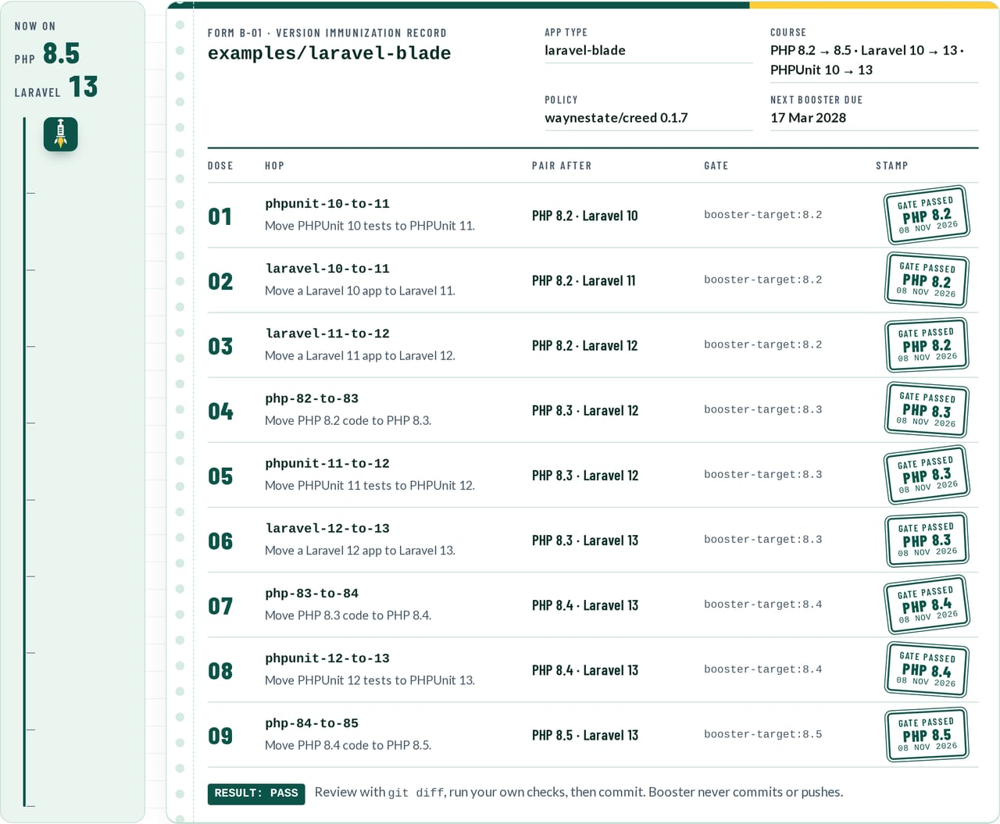
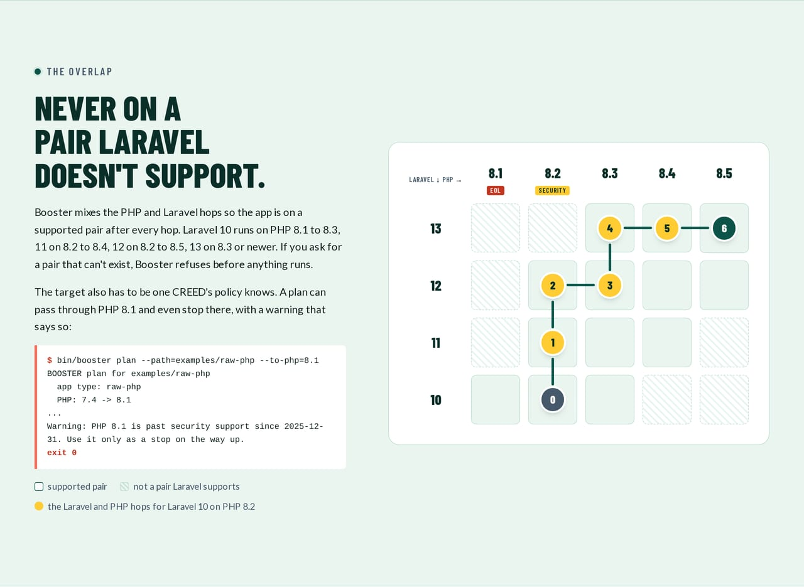

# Quick start

This page runs Booster on an app for the first time. Next: [What a hop does](hops.md) for what each step does.

```
booster detect --path=../my-app        # which of the five permutations, and which versions
booster plan   --path=../my-app        # the ordered hops to a supported version
booster scan   --path=../my-app --php=8.0   # what will break on that PHP; advisory, changes nothing
booster run    --path=../my-app --dry-run   # the diffs Rector would make; changes nothing
booster run    --path=../my-app        # apply the plan, one hop at a time, with a test gate
```

The one-command form for a forced image upgrade:

```
booster run --path=../my-app --goal=php-74-to-84
```

When the app carries a `composer.lock`, `detect` also reads the PHP range the locked packages allow: the highest
`require.php` floor and the lowest ceiling across `packages` and `packages-dev`, raised by a `platform-overrides.php`
or `config.platform.php` pin in `composer.json` when one is set. If that floor sits above the floor `composer.json`
claims, Booster plans from the lock's floor and prints a warning saying so; if the first PHP hop lands at or above
the lock's ceiling, a second warning notes that hop will need a `composer update` to keep the lock installable.
Without a lock, `composer.json` stays the sole source.

A plan for the bundled Laravel 10 example app on PHP 8.2 looks like this (the order keeps the app on a PHP and
Laravel pair Laravel supports at every step):

```
$ booster plan --path=examples/laravel-blade --today=2026-10-29

BOOSTER plan for examples/laravel-blade
  app type: laravel-blade
  PHP: 8.2 -> 8.5
  Laravel: 10 -> 13
  PHPUnit: 10 -> 13
  policy: waynestate/creed 0.1.4 (today 2026-10-29)

1. phpunit-10-to-11
   Move PHPUnit 10 tests to PHPUnit 11.
   After this step your tests run in Docker.
2. laravel-10-to-11
   Move a Laravel 10 app to Laravel 11.
   After this step your tests run in Docker.
3. laravel-11-to-12
   Move a Laravel 11 app to Laravel 12.
   After this step your tests run in Docker.
    Behavior changes to check:
   When the app does not define a local disk, its root now defaults to storage/app/private instead of storage/app (config/filesystems.php)
     keep old: define the local disk with 'root' => storage_path('app')
     check: Check where Storage::disk('local') writes after the hop
4. php-82-to-83
   Move PHP 8.2 code to PHP 8.3.
   After this step your tests run in Docker.
   Removed between PHP 8.2 and PHP 8.3: none found.
5. phpunit-11-to-12
   Move PHPUnit 11 tests to PHPUnit 12.
   After this step your tests run in Docker.
6. laravel-12-to-13
   Move a Laravel 12 app to Laravel 13.
   After this step your tests run in Docker.
7. php-83-to-84
   Move PHP 8.3 code to PHP 8.4.
   After this step your tests run in Docker.
   Removed between PHP 8.3 and PHP 8.4: none found.
8. phpunit-12-to-13
   Move PHPUnit 12 tests to PHPUnit 13.
   After this step your tests run in Docker.
9. php-84-to-85
   Move PHP 8.4 code to PHP 8.5.
   After this step your tests run in Docker.
   Removed between PHP 8.4 and PHP 8.5: none found.

PHPCompatibility check for PHP 8.3: no findings.

PHPStan on PHP 8.5: 5 findings (code quality hints, not upgrade blockers).
   app/Models/Post.php:7 [class.notFound] Class App\Models\Post extends unknown class Illuminate\Database\Eloquent\Model.
   app/Models/Post.php:9 [missingType.property] Property App\Models\Post::$casts has no type specified.
   tests/PostTest.php:18 [property.onlyWritten] Property App\Tests\PostTest::$repository is never read, only written.
   tests/PostTest.php:27 [staticMethod.deprecated] Call to deprecated method isType() of class PHPUnit\Framework\Assert:
https://github.com/sebastianbergmann/phpunit/issues/6052
   tests/PostTest.php:33 [method.alreadyNarrowedType] Call to method PHPUnit\Framework\Assert::assertNotNull() with PHPUnit\Framework\MockObject\Rule\AnyInvokedCount will always evaluate to true.
   Hint: Laravel app without Larastan: Eloquent and facade calls show as errors. composer require --dev larastan/larastan for a cleaner scan.

Nothing was changed. The numbered list above is the order Booster would do things; "PHPCompatibility check" and "PHPStan" are advice
for you to read, not errors.
Booster does every step above marked automatic when you run it.
Preview the edits: booster run --path=examples/laravel-blade --dry-run
(The real run needs Docker, and your app committed in git: booster run --path=examples/laravel-blade)
```

<div align="center">
  
  <br><sub>The plan's Laravel and PHP hops, written up the way your doctor would: one stamp per hop, one hop at a time.</sub>
</div>

<details>
<summary><b>Chart review</b>: the record card and the PHP by Laravel grid, from the front page</summary>
<br>
<div align="center">
  
  <br><br>
  
</div>
</details>
